# Guia completo de uso da Orkestral

**Versão do guia:** 1.0  
**Atualizado em:** 20/07/2026  
**Ambiente das imagens:** desenvolvimento local com dados fictícios

## 1. Para quem é este guia

Este documento foi escrito para proprietários de empresas, administradores, gestores e operadores que precisam usar a Orkestral sem conhecer programação. Ele também serve como roteiro para demonstrar a plataforma a um cliente e treinar a equipe.

O guia explica:

- o que é a Orkestral;
- como entrar e encontrar cada função;
- como ativar módulos;
- como organizar empresas, usuários e permissões;
- como cadastrar contatos;
- como criar agentes de inteligência artificial;
- como criar uma base de conhecimento;
- como configurar integrações sem expor senhas;
- como montar, validar e publicar automações;
- como testar antes de colocar um fluxo em uso;
- como diagnosticar os problemas mais comuns.

## 2. O que é a Orkestral

A Orkestral é um centro de operações empresariais. Em vez de usar ferramentas isoladas para contatos, automações, inteligência artificial, documentos, notificações e integrações, a empresa controla tudo em um só lugar.

Em linguagem simples, ela permite:

1. receber uma informação de um cliente ou sistema;
2. decidir o que deve acontecer com essa informação;
3. executar tarefas automaticamente;
4. pedir aprovação humana quando houver risco;
5. registrar o resultado para auditoria;
6. medir tempo, volume, custo e falhas.

A plataforma é multiempresa. Isso significa que cada empresa possui dados, usuários, permissões, módulos, integrações e automações isolados. Um usuário só deve ver aquilo que sua empresa e seu papel permitem.

## 3. Endereços de acesso

| Finalidade                         | Endereço                                                    |
| ---------------------------------- | ----------------------------------------------------------- |
| Ambiente remoto de desenvolvimento | <https://orkestral-development.onrender.com/app>            |
| Login remoto                       | <https://orkestral-development.onrender.com/login>          |
| Ambiente local                     | <http://localhost/app>                                      |
| Login local                        | <http://localhost/login>                                    |
| Saúde da API local                 | <http://localhost/health>                                   |
| Prontidão da API local             | <http://localhost/ready>                                    |
| Versão remota                      | <https://orkestral-development.onrender.com/system/version> |

O ambiente remoto atual é de desenvolvimento. Use somente dados fictícios. Não coloque documentos, contatos, senhas ou informações reais de clientes nesse ambiente.

## 4. Conceitos essenciais

| Conceito             | Explicação simples                                                          |
| -------------------- | --------------------------------------------------------------------------- |
| Empresa              | Espaço isolado de uma organização dentro da plataforma.                     |
| Usuário              | Pessoa que entra na plataforma.                                             |
| Papel                | Conjunto de permissões, como administrador, gestor ou operador.             |
| Módulo               | Área de negócio que pode ser ativada, como CRM, RH ou Projetos.             |
| Integração           | Conexão segura com outro serviço, como e-mail, calendário ou WhatsApp.      |
| Credencial           | Segredo usado por uma integração. Deve ficar no cofre, nunca em documentos. |
| Agente               | Especialista de IA com instruções e ferramentas autorizadas.                |
| Base de conhecimento | Coleção de documentos e fontes consultadas por agentes.                     |
| Automação            | Sequência visual de gatilhos, decisões e ações.                             |
| Gatilho              | Evento que inicia uma automação.                                            |
| Bloco                | Etapa de uma automação.                                                     |
| Aprovação humana     | Pausa obrigatória para uma pessoa autorizar uma ação sensível.              |
| Rascunho             | Fluxo salvo, mas ainda não publicado.                                       |
| Publicação           | Envio de uma versão validada para o motor de automação.                     |

## 5. Primeiro acesso

### 5.1 Entrar

1. Abra o endereço de login do ambiente desejado.
2. Informe seu e-mail empresarial e sua senha.
3. Se estiver no ambiente local de desenvolvimento, o botão de acesso administrativo pode estar disponível.
4. Confirme no topo da tela qual empresa e qual ambiente estão ativos.
5. Nunca compartilhe sua sessão ou senha por mensagem.

### 5.2 Reconhecer o ambiente

O topo da aplicação mostra o nome do ambiente. Nas imagens deste guia aparece `Orkestral Desenvolvimento`. Esse aviso existe para impedir que dados de teste sejam confundidos com produção.

### 5.3 Sair com segurança

Use o botão de saída no canto superior direito. Em computador compartilhado, feche também o navegador.

## 6. Mapa das telas

Substitua `BASE` por `http://localhost` ou `https://orkestral-development.onrender.com`.

| Área               | Endereço                |
| ------------------ | ----------------------- |
| Visão geral        | `BASE/app`              |
| Central de atenção | `BASE/app/notificacoes` |
| Automações         | `BASE/app/automacoes`   |
| Agentes            | `BASE/app/agentes`      |
| Conhecimento       | `BASE/app/conhecimento` |
| Integrações        | `BASE/app/integracoes`  |
| Módulos            | `BASE/app/modulos`      |
| Plano e consumo    | `BASE/app/plano`        |
| Contatos           | `BASE/app/crm/contatos` |
| Usuários           | `BASE/app/usuarios`     |
| Papéis             | `BASE/app/papeis`       |
| Empresas           | `BASE/app/empresas`     |
| Meu perfil         | `BASE/app/perfil`       |

## 7. Visão geral

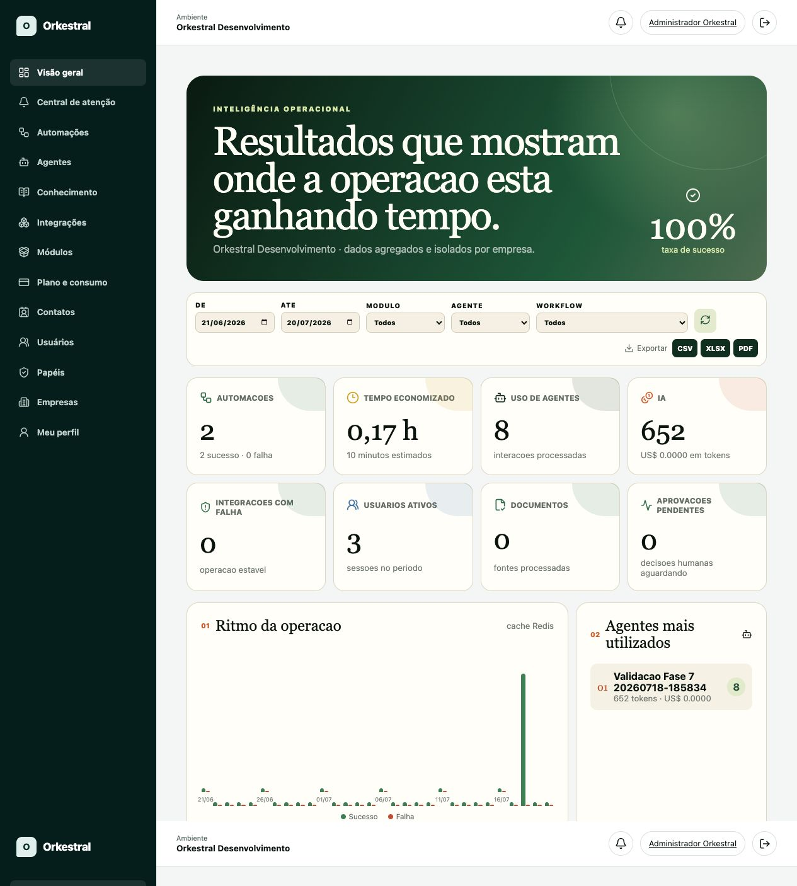

A Visão geral apresenta indicadores consolidados da empresa:

- automações executadas;
- taxa de sucesso;
- tempo economizado;
- uso de agentes;
- consumo de tokens;
- falhas de integração;
- usuários ativos;
- documentos processados;
- aprovações pendentes.

### Como usar os filtros

1. Escolha o período em `De` e `Até`.
2. Filtre por módulo, agente ou workflow quando necessário.
3. Clique em `Atualizar métricas`.
4. Use CSV, XLSX ou PDF somente quando precisar compartilhar um relatório.
5. Antes de enviar o arquivo, confirme que ele não contém informações que o destinatário não pode ver.

## 8. Módulos da empresa

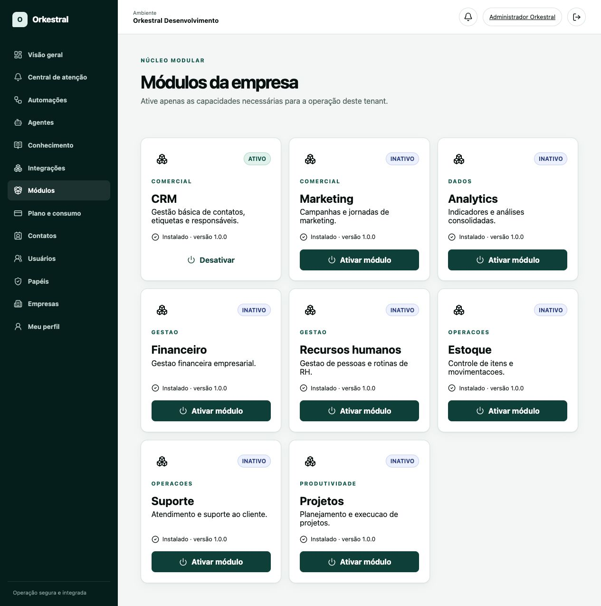

Um módulo pode estar em dois estados diferentes:

- **Instalado:** o código existe e está pronto para uso.
- **Ativo:** a empresa decidiu usar o módulo e concedeu suas capacidades.

`Instalado · versão 1.0.0` não significa que o módulo já está ativo. O botão `Ativar módulo` conclui essa escolha para a empresa atual.

### Ativar um módulo

1. Abra `Módulos`.
2. Localize a área desejada.
3. Confirme que aparece `Instalado · versão 1.0.0`.
4. Clique em `Ativar módulo`.
5. Aguarde a confirmação.
6. Verifique se o novo item apareceu no menu.
7. Configure os papéis que poderão acessar o módulo.

### Desativar um módulo

1. Confirme que nenhuma automação depende dele.
2. Exporte informações importantes quando aplicável.
3. Clique em `Desativar`.
4. Confirme que usuários comuns perderam o acesso.

Desativar não deve apagar automaticamente os dados. Mesmo assim, faça essa operação somente com autorização do responsável pela empresa.

## 9. Empresas, usuários e papéis

### 9.1 Empresas

Use `Empresas` para cadastrar e administrar organizações isoladas. Verifique sempre a empresa ativa antes de editar qualquer informação.

### 9.2 Usuários

Use `Usuários` para convidar pessoas, acompanhar status e revogar acessos. Cada pessoa deve possuir sua própria conta.

Nunca crie uma conta compartilhada para uma equipe inteira.

### 9.3 Papéis

Use `Papéis` para aplicar o princípio do menor privilégio:

- proprietário: controle total e decisões administrativas;
- administrador: configuração operacional autorizada;
- gestor: acompanhamento e aprovação dentro de sua área;
- operador: execução das tarefas permitidas;
- leitura: consulta sem alteração.

Ao criar um papel, habilite somente as permissões necessárias. Teste com um usuário de demonstração antes de aplicar a pessoas reais.

## 10. Contatos e CRM

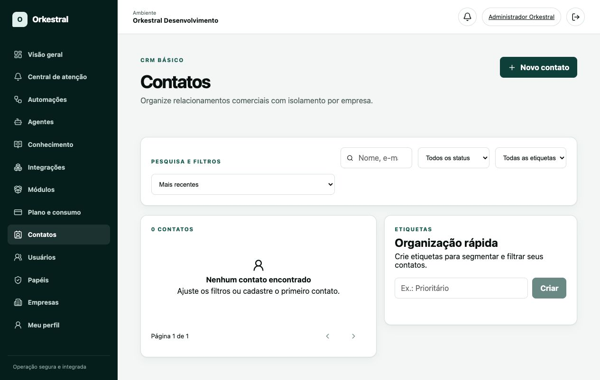

O CRM organiza leads, prospects, clientes e contatos inativos.

### Cadastrar um contato

1. Abra `Contatos`.
2. Clique em `Novo contato`.
3. Preencha os dados autorizados.
4. Escolha o status correto.
5. Adicione etiquetas úteis, sem incluir informação sensível no nome da etiqueta.
6. Salve.

### Organizar contatos

- use a busca para localizar nome, empresa ou informação permitida;
- filtre por status;
- filtre por etiqueta;
- ordene por data ou nome;
- mantenha responsáveis e status atualizados.

### Exemplo de etiquetas

- `Origem - Site`
- `Prioridade - Alta`
- `Interesse - Consultoria`
- `Aguardando retorno`

Evite etiquetas como senhas, dados médicos, documentos pessoais ou observações ofensivas.

## 11. Central de atenção e aprovações

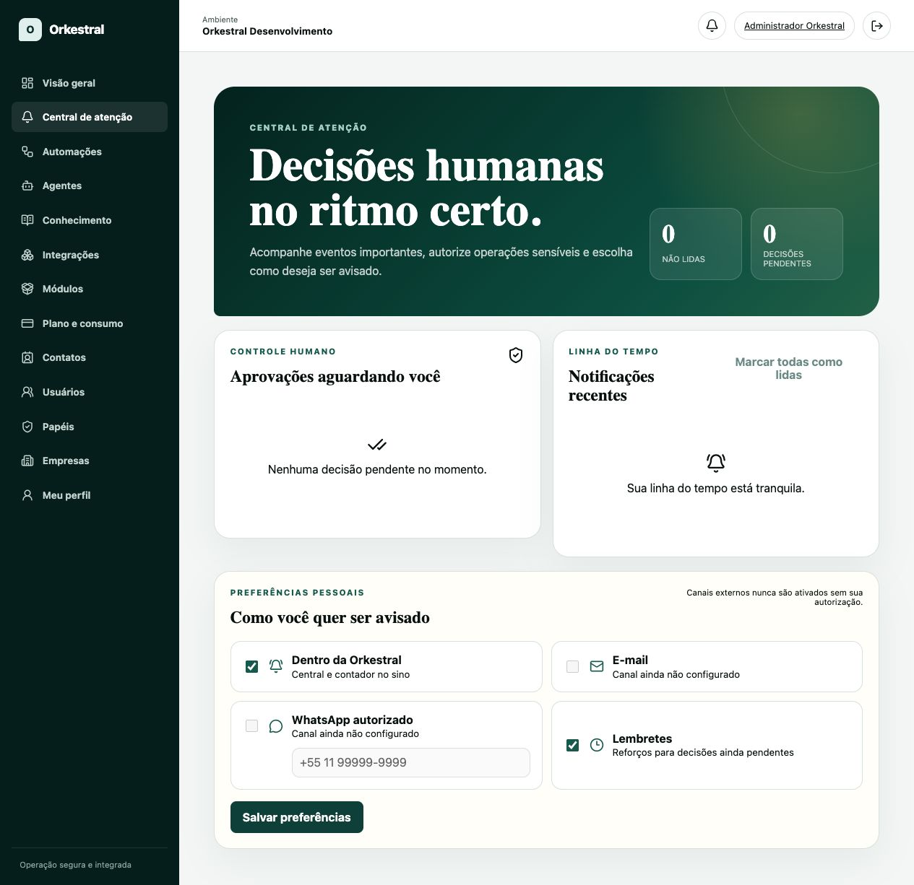

A Central de atenção reúne notificações e ações que dependem de decisão humana.

### Quando uma aprovação deve ser usada

- envio de mensagem em massa;
- exclusão ou alteração de dados importantes;
- movimentação financeira;
- desativação de automação crítica;
- resposta de IA com impacto jurídico ou comercial;
- ação irreversível em sistema externo.

### Processar uma aprovação

1. Leia o motivo e os dados resumidos.
2. Confirme a empresa, o fluxo e a pessoa solicitante.
3. Avalie o impacto.
4. Aprove ou rejeite.
5. Registre uma justificativa clara quando o formulário permitir.

Não aprove uma ação apenas para retirar a notificação da fila.

## 12. Integrações

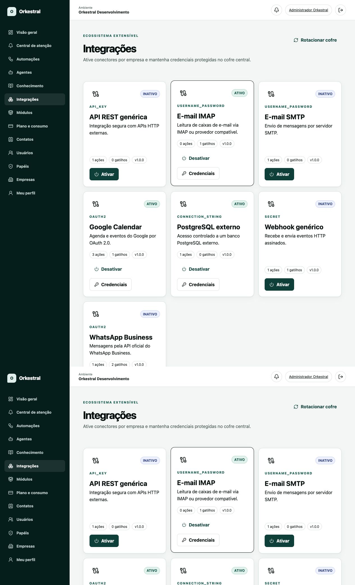

As integrações conectam a Orkestral a serviços externos. O catálogo atual inclui:

- API REST genérica;
- E-mail IMAP;
- E-mail SMTP;
- Google Calendar;
- PostgreSQL externo;
- Webhook genérico;
- WhatsApp Business.

### 12.1 Regra de segurança

Credenciais devem ser cadastradas somente no cofre da tela de Integrações. Nunca coloque senhas, tokens ou chaves:

- no nome de uma automação;
- na descrição de um bloco;
- em documentos da base de conhecimento;
- no GitHub;
- em capturas de tela;
- em mensagens de suporte.

### 12.2 Ativar um conector

1. Abra `Integrações`.
2. Localize o conector.
3. Leia o tipo de autenticação exibido no cartão.
4. Clique em `Ativar`.
5. Clique em `Credenciais`.
6. Dê um nome reconhecível, como `SMTP - Homologação`.
7. Preencha somente os campos fornecidos pelo provedor.
8. Clique em `Criptografar e salvar`.
9. Use dados de teste antes de conectar uma conta real.

### 12.3 E-mail IMAP

O IMAP permite ler mensagens recebidas.

Informações normalmente necessárias:

- servidor IMAP;
- porta, geralmente 993 com SSL;
- usuário;
- senha de aplicativo ou token;
- uso de SSL.

Prefira senha de aplicativo ou OAuth quando o provedor oferecer. Não use a senha principal da conta pessoal.

### 12.4 E-mail SMTP

O SMTP permite enviar mensagens. Configure um remetente exclusivo de teste e limite os destinatários durante a homologação.

Antes de liberar:

1. envie para um endereço interno;
2. confirme remetente, assunto e corpo;
3. valide acentuação e links;
4. confirme que não existe repetição automática;
5. adicione aprovação humana para campanhas ou mensagens sensíveis.

### 12.5 Google Calendar

O Google Calendar usa OAuth 2.0. A pessoa autorizadora deve entrar na conta correta e revisar os escopos solicitados.

Use uma agenda de testes. Valide criação, consulta e atualização de eventos antes de usar uma agenda comercial.

### 12.6 API REST genérica

Use para consultar ou enviar dados a uma API HTTP autorizada.

Defina:

- URL base HTTPS;
- método permitido;
- cabeçalhos sem segredo no fluxo;
- credencial armazenada no cofre;
- tempo limite;
- tratamento para códigos 400, 401, 403, 429 e 500.

### 12.7 PostgreSQL externo

Use uma conta exclusiva, com acesso somente às tabelas necessárias. Para relatórios, prefira permissão de leitura.

Nunca conecte o ambiente de desenvolvimento diretamente ao banco de produção de um cliente.

### 12.8 Webhook

O webhook recebe eventos de outro sistema. Proteja-o com segredo, assinatura e limitação de requisições.

Exemplo fictício de evento:

```json
{
  "event": "lead.created",
  "lead": {
    "name": "Cliente Exemplo",
    "email": "cliente@example.test",
    "phone": "+55 11 90000-0000",
    "source": "site"
  }
}
```

### 12.9 WhatsApp Business

Use somente a API oficial e números autorizados. Garanta consentimento do destinatário, modelos aprovados quando exigidos e opção de interrupção de mensagens.

## 13. Base de conhecimento

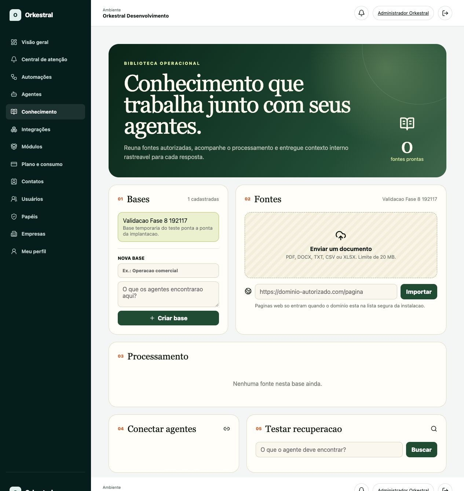

A base de conhecimento permite que agentes consultem documentos autorizados em vez de responder apenas com conhecimento geral.

### Criar uma base

1. Abra `Conhecimento`.
2. Informe um nome objetivo, como `Políticas de atendimento`.
3. Explique o que os agentes encontrarão.
4. Clique em `Criar base`.

### Adicionar fontes

As fontes podem incluir PDF, DOCX, TXT, CSV ou XLSX dentro do limite mostrado na tela. Páginas web somente devem ser importadas quando o domínio estiver na lista segura.

1. Selecione a base.
2. Envie o documento ou informe uma URL autorizada.
3. Aguarde o processamento.
4. Confirme que a fonte aparece como pronta.
5. Teste a recuperação com uma pergunta cuja resposta exista no documento.

### Qualidade da base

- use documentos atuais;
- remova versões antigas;
- não misture assuntos sem necessidade;
- informe fonte, data e responsável;
- não envie dados reais ao ambiente de desenvolvimento;
- revise respostas antes de permitir ações automáticas.

## 14. Agentes de inteligência artificial

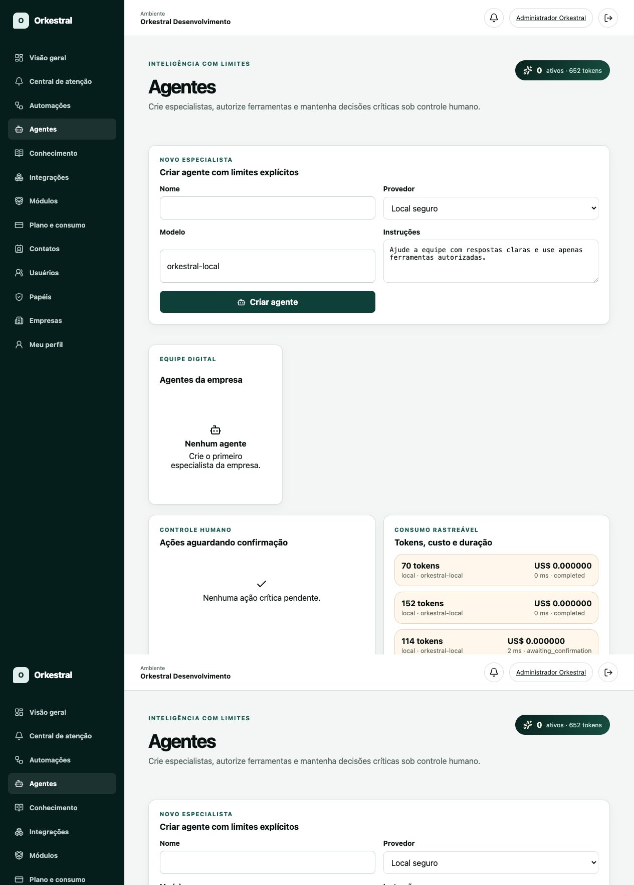

Um agente é um especialista com instruções, modelo, base de conhecimento e ferramentas limitadas.

### Criar um agente

1. Abra `Agentes`.
2. Informe um nome funcional, como `Assistente de atendimento`.
3. Escolha o provedor autorizado.
4. Escolha o modelo.
5. Escreva instruções claras.
6. Clique em `Criar agente`.
7. Conecte apenas as bases e ferramentas necessárias.
8. Teste perguntas simples, ambíguas e perigosas.

### Exemplo de instrução

```text
Você é o assistente de atendimento da Empresa Exemplo.
Responda somente com base nas fontes autorizadas.
Quando não encontrar a resposta, diga que precisa de ajuda humana.
Nunca invente preço, prazo, política ou condição comercial.
Antes de enviar mensagem externa ou alterar dados, solicite aprovação humana.
```

### Ferramentas e controle humano

Uma ferramenta permite que o agente consulte ou altere algo. Autorize leitura quando leitura for suficiente. Ações críticas devem exigir aprovação humana.

A tela também mostra tokens, custo, duração e resultado de cada execução. Use essas informações para identificar excesso de consumo e falhas.

## 15. Automações

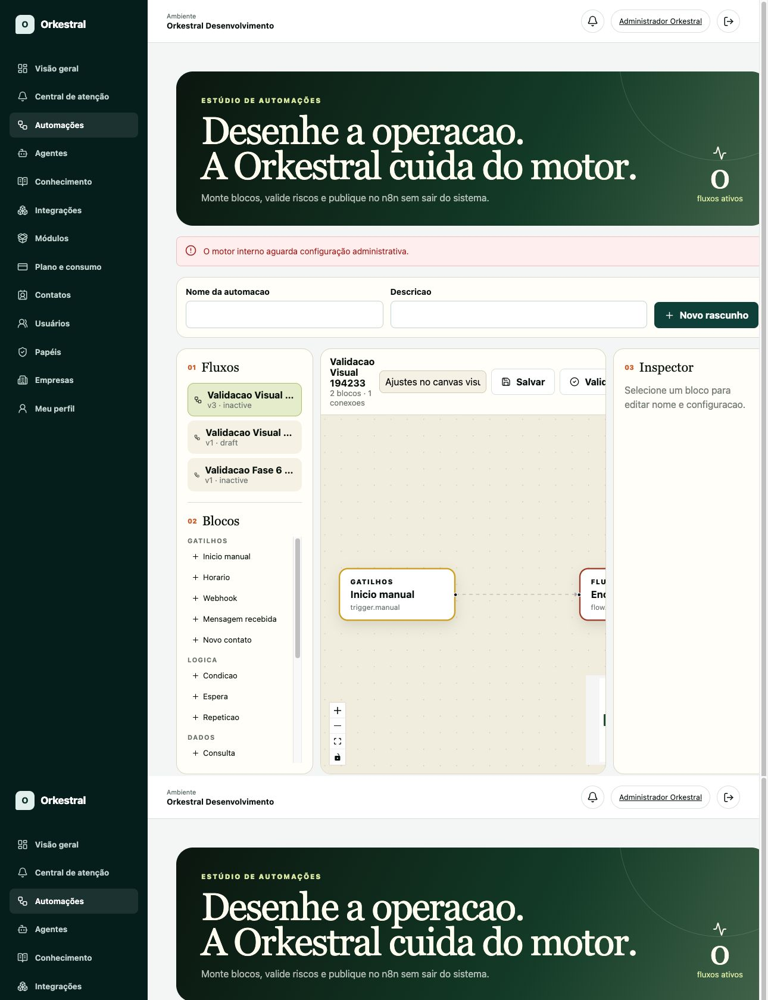

O editor transforma um processo em blocos conectados.

### 15.1 Tipos de bloco

| Grupo        | Blocos disponíveis                                               | Uso típico                         |
| ------------ | ---------------------------------------------------------------- | ---------------------------------- |
| Gatilhos     | Início manual, Horário, Webhook, Mensagem recebida, Novo contato | Iniciar o fluxo.                   |
| Lógica       | Condição, Espera, Repetição                                      | Decidir, aguardar ou repetir.      |
| Dados        | Consulta, Atualização                                            | Ler ou alterar dados autorizados.  |
| Ações        | E-mail, Mensagem, Plugin                                         | Agir em sistemas conectados.       |
| Inteligência | Agente, Aprovação humana                                         | Analisar com IA e controlar risco. |
| Fluxo        | Encerramento                                                     | Finalizar com resultado claro.     |

### 15.2 Criar um rascunho

1. Abra `Automações`.
2. Informe nome e descrição.
3. Clique em `Novo rascunho`.
4. Escolha um único gatilho inicial.
5. Adicione blocos na ordem do processo real.
6. Selecione cada bloco e preencha o Inspector.
7. Conecte saída e entrada dos blocos.
8. Adicione um encerramento para cada caminho possível.
9. Escreva um resumo da alteração.
10. Clique em `Salvar`.

### 15.3 Validar

Clique em `Validar` e corrija todos os problemas encontrados. Uma validação deve conferir pelo menos:

- existência de gatilho;
- caminhos sem saída;
- blocos sem configuração;
- credenciais ausentes;
- integração inativa;
- ação crítica sem aprovação;
- condição sem caminho alternativo;
- repetição sem limite;
- dados obrigatórios ausentes.

### 15.4 Publicar

Publique somente depois de salvar, validar e testar. A publicação depende do motor de automação configurado. Quando a tela informar `O motor interno aguarda configuração administrativa`, mantenha o fluxo como rascunho; não considere a ação executada.

### 15.5 Versões

Cada alteração importante deve possuir um resumo. Use o histórico para comparar, restaurar ou duplicar uma versão. Prefira duplicar quando quiser testar uma mudança grande sem afetar o fluxo atual.

## 16. Exemplo prático 1 - atendimento automático de lead

### Objetivo

Receber um lead do site, cadastrar no CRM, classificá-lo com um agente, pedir aprovação para prioridade alta e enviar uma resposta.

### Pré-requisitos

- CRM ativo;
- Webhook genérico ativo;
- SMTP ou WhatsApp configurado com conta de teste;
- agente `Qualificador de leads`;
- papel com permissões de contatos, agentes e automações.

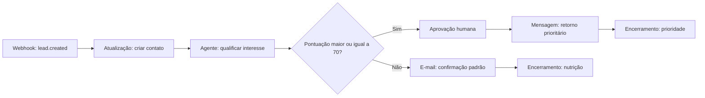

### Configuração sugerida

1. Crie o rascunho `Atendimento de lead do site`.
2. Adicione o gatilho `Webhook` e selecione a credencial de teste.
3. Adicione `Atualização` para criar o contato com status `Lead`.
4. Adicione o agente e peça uma saída estruturada com `score`, `motivo` e `proxima_acao`.
5. Adicione a condição `score >= 70`.
6. No caminho positivo, inclua aprovação humana.
7. Depois da aprovação, envie mensagem pelo canal autorizado.
8. No caminho negativo, envie somente uma confirmação simples.
9. Finalize os dois caminhos.
10. Teste com payload fictício e confirme que não há duplicação.

### Critérios de aceite

- um evento cria somente um contato;
- o agente não inventa informação;
- prioridade alta exige pessoa responsável;
- falha do canal não apaga o contato;
- o resultado aparece na auditoria.

## 17. Exemplo prático 2 - agente que responde usando documentos

### Objetivo

Responder perguntas internas com base em manuais autorizados e encaminhar dúvidas sem resposta para uma pessoa.

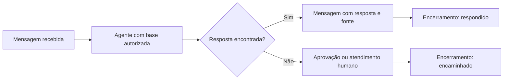

### Passo a passo

1. Crie a base `Manual interno`.
2. Envie somente documentos fictícios ou autorizados.
3. Aguarde todas as fontes ficarem prontas.
4. Teste a busca na própria tela de Conhecimento.
5. Crie o agente `Assistente do manual`.
6. Conecte somente a base `Manual interno`.
7. Instrua o agente a citar a fonte e reconhecer quando não sabe.
8. Monte a automação com `Mensagem recebida`.
9. Adicione uma condição para resposta encontrada.
10. Encaminhe respostas ausentes para atendimento humano.

### Testes mínimos

- pergunta com resposta literal;
- pergunta com sinônimo;
- pergunta fora do assunto;
- tentativa de obter dados de outra empresa;
- instrução maliciosa dentro de um documento;
- documento antigo substituído por versão atual.

## 18. Exemplo prático 3 - relatório operacional diário

### Objetivo

Consultar dados autorizados, resumir com um agente e enviar um relatório interno após aprovação.

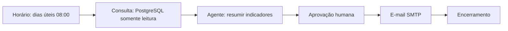

### Passo a passo

1. Crie uma credencial PostgreSQL exclusiva e somente leitura.
2. Crie uma credencial SMTP de homologação.
3. Crie o agente `Analista operacional` sem ferramentas de escrita.
4. Adicione o gatilho `Horário` para dias úteis.
5. Configure a consulta com limite de linhas e tempo máximo.
6. Peça ao agente resumo, alertas e indicadores, sem inventar valores.
7. Adicione aprovação humana antes do e-mail.
8. Envie primeiro para um destinatário interno de teste.
9. Confirme que uma falha de consulta impede o envio.
10. Publique somente depois de três execuções manuais corretas.

## 19. Exemplo prático 4 - agendamento comercial

### Objetivo

Criar um evento no Google Calendar quando um lead aprovado solicitar reunião.

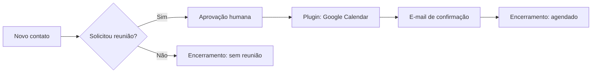

Use uma agenda de testes, valide fuso horário, duração, participantes e tratamento de conflito antes de liberar.

## 20. Plano e consumo

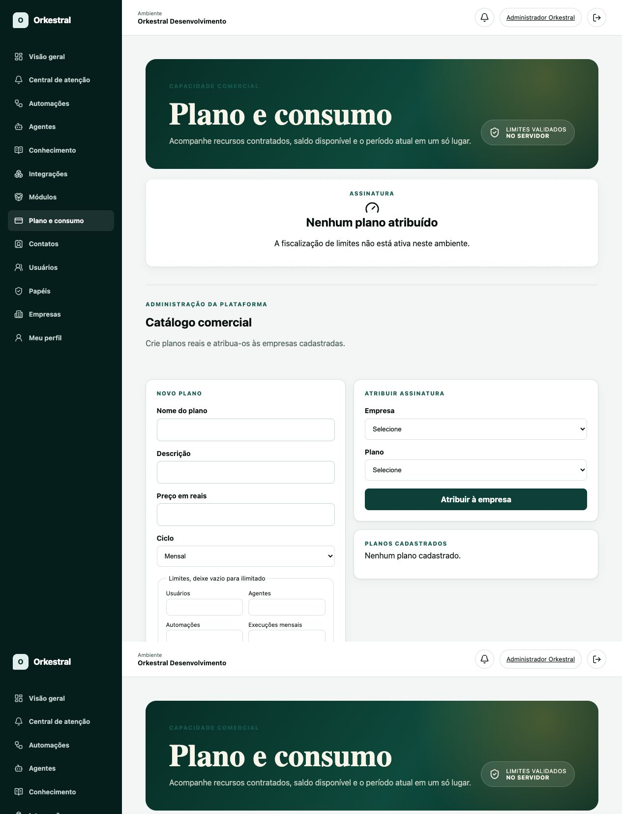

A tela mostra assinatura, limites e consumo. Administradores da plataforma também podem cadastrar planos e atribuí-los às empresas.

Antes de criar um plano, defina:

- quantidade de usuários;
- quantidade de agentes;
- quantidade de automações;
- execuções mensais;
- tokens mensais;
- armazenamento;
- integrações;
- documentos;
- chamadas de API;
- preço e ciclo.

O servidor deve fiscalizar os limites. Nunca confie somente em bloqueios visuais do navegador.

## 21. Checklist de teste de uma automação

### Dados

- [ ] usar somente dados fictícios no desenvolvimento;
- [ ] testar campos ausentes;
- [ ] testar texto muito longo;
- [ ] testar evento duplicado;
- [ ] confirmar isolamento entre empresas.

### Integrações

- [ ] credencial armazenada no cofre;
- [ ] conta externa exclusiva de teste;
- [ ] HTTPS ativo;
- [ ] tempo limite configurado;
- [ ] erro 401 tratado;
- [ ] erro 429 tratado;
- [ ] erro 500 tratado.

### Fluxo

- [ ] existe um gatilho claro;
- [ ] todos os caminhos terminam;
- [ ] repetição possui limite;
- [ ] ação crítica exige aprovação;
- [ ] falha não dispara envio duplicado;
- [ ] versão e resumo foram salvos.

### Resultado

- [ ] execução aparece no histórico;
- [ ] consumo aparece na visão geral;
- [ ] falha gera informação compreensível;
- [ ] rollback foi entendido;
- [ ] responsável aprovou a publicação.

## 22. Problemas comuns

| Problema                              | Causa provável                                                     | O que fazer                                                            |
| ------------------------------------- | ------------------------------------------------------------------ | ---------------------------------------------------------------------- |
| Tela antiga após atualização          | Cache do navegador                                                 | Use `Cmd + Shift + R` no macOS ou recarregamento completo equivalente. |
| Módulo mostra `Inativo`               | Está instalado, mas não foi ativado para a empresa                 | Abra Módulos e clique em `Ativar módulo`.                              |
| Botão de publicar não funciona        | Motor n8n desativado ou não configurado                            | Mantenha o fluxo como rascunho e peça configuração administrativa.     |
| Integração não executa                | Conector ou credencial inativa                                     | Confirme Ativar, Credenciais e permissões.                             |
| API demora na primeira abertura       | Serviço gratuito estava suspenso                                   | Aguarde alguns instantes e tente novamente.                            |
| Usuário não vê um menu                | Papel sem permissão ou módulo inativo                              | Revise Papéis e Módulos para a empresa correta.                        |
| Agente não encontra resposta          | Base não conectada, fonte processando ou pergunta fora do conteúdo | Revise Conhecimento, aguarde processamento e teste recuperação.        |
| E-mail duplicado                      | Repetição, retentativa ou evento duplicado sem idempotência        | Desative o fluxo e revise chave única e política de retentativa.       |
| Webhook recebe chamadas desconhecidas | Segredo ausente ou vazado                                          | Rotacione o segredo, valide assinatura e limite origens.               |

## 23. Segurança para operadores

1. Não compartilhe senha.
2. Não envie token por e-mail ou chat.
3. Não fotografe uma tela com credencial aberta.
4. Confirme a empresa ativa.
5. Use aprovação humana para ações sensíveis.
6. Revogue acessos de pessoas desligadas.
7. Mantenha integrações com o menor privilégio.
8. Use dados fictícios em desenvolvimento.
9. Registre motivo e responsável por alterações importantes.
10. Em caso de dúvida, desative o fluxo antes de investigar.

## 24. Entrega da plataforma para uma empresa

Antes de entregar acesso a um cliente:

- [ ] confirmar ambiente correto;
- [ ] criar a empresa;
- [ ] criar proprietário e papéis;
- [ ] ativar somente módulos contratados;
- [ ] cadastrar usuários individualmente;
- [ ] configurar integrações com contas da empresa;
- [ ] importar somente dados autorizados;
- [ ] testar isolamento multiempresa;
- [ ] criar automações inicialmente como rascunho;
- [ ] executar testes de sucesso e falha;
- [ ] definir responsáveis por aprovações;
- [ ] treinar usuários com este guia;
- [ ] entregar canal de suporte;
- [ ] registrar versão publicada;
- [ ] confirmar backup e rollback antes de produção.

## 25. Resumo para novos usuários

Se você acabou de receber acesso, siga esta ordem:

1. abra a Visão geral;
2. confirme a empresa ativa;
3. revise seu perfil;
4. veja a Central de atenção;
5. conheça os módulos ativos;
6. consulte contatos e dados permitidos;
7. não altere integrações sem autorização;
8. crie automações como rascunho;
9. valide e teste com dados fictícios;
10. peça aprovação antes de publicar algo com impacto externo.

## 26. Limitações do ambiente atual

O ambiente remoto gratuito é destinado a demonstração e testes. Ele pode iniciar lentamente depois de ficar inativo. Serviços opcionais, como n8n, worker, armazenamento ou envio externo, podem estar desativados.

Uma tela disponível não garante que uma integração externa esteja configurada. A interface deve informar quando o motor ou o conector não estiver disponível. Nunca simule que uma ação foi executada.

Produção exige infraestrutura própria, segredos exclusivos, backups, monitoramento, domínio oficial e dados reais tratados de acordo com as políticas aplicáveis.
