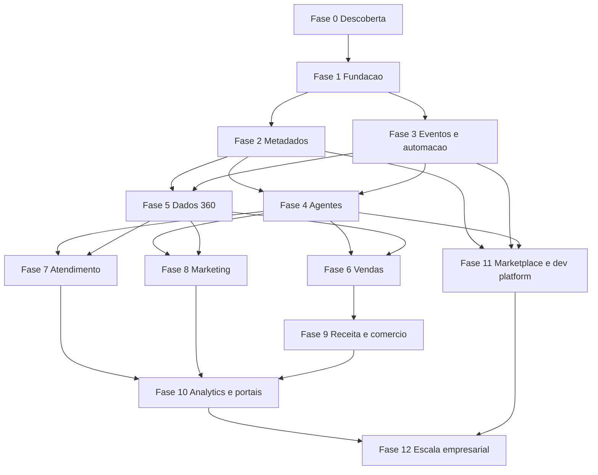

# Roadmap empresarial do Orkestral

Versao: 1.0

Data: 21 de julho de 2026.

## Objetivo

Transformar a plataforma atual em um sistema operacional empresarial modular, orientado por metadados, eventos e agentes controlados. O roadmap e ordenado por dependencia e risco, nao por impacto visual imediato.

## Estado de partida

- Fase 0 concluida como diagnostico e linha de base.
- Fase 1 parcial: tenant, permissoes, auditoria e testes estruturais existem.
- Modulos de negocio em Nivel 2, com automacao em Nivel 3.
- GitHub Actions bloqueado externamente por conta/limite e sem branch protection no plano privado atual.
- Producao para clientes reais ainda nao autorizada.

## Regras de execucao

1. Entregas pequenas e verticais.
2. Migracoes expand/contract e reversiveis quando possivel.
3. Nenhuma fase e concluida apenas com documentacao.
4. Cada tres entregas formam um PR.
5. Merge somente com checks obrigatorios aprovados.
6. Repositorio permanece privado.
7. Teste negativo entre empresas acompanha todo novo dominio.
8. Segredo, dado real e recurso pago nao entram por conveniencia.

## Sequencia de dependencias

## Fase 0 - Descoberta e estabilizacao

Situacao: concluida para a linha de base de 21/07/2026.

Entregas:

1. Inventario de repositorio, containers e modulos.
2. Linha de base de testes, health, migracoes e seguranca.
3. Pesquisa oficial e auditorias de tenant, agentes e automacoes.

Saida:

- inventario funcional;
- matriz de equivalencia;
- arquitetura-alvo;
- riscos e proximo passo mensuravel.

## Fase 1 - Fundacao empresarial

Objetivo: tornar tenant, autorizacao, auditoria, erro e idempotencia contratos impossiveis de ignorar.

Pacote 1A:

1. `TenantContext` obrigatorio em servicos e jobs.
2. Policy contract central para acao, registro e campo.
3. Testes negativos ampliados para todos os dominios.

Pacote 1B:

1. Auditoria unificada e redacao central.
2. Idempotency key para mutacoes externas/criticas.
3. Erros padronizados com correlation ID.

Pacote 1C:

1. ADR e prototipo de constraints compostas/RLS.
2. Retencao e eliminacao verificavel por dominio.
3. Rate limit por empresa e rota sensivel.

Criterio de saida:

- nenhuma tabela, rota, job ou evento empresarial opera sem tenant explicito;
- testes A->B cobrem leitura, escrita, exportacao e execucao;
- auditoria nao registra segredo;
- policy decisions sao reproduziveis.

## Fase 2 - Plataforma de metadados

Objetivo: permitir aplicacoes e registros configuraveis sem alterar o nucleo.

Pacote 2A:

1. Application, Module e Entity Definition.
2. Field e Relationship Definition.
3. Draft, validate, publish e rollback.

Pacote 2B:

1. API de registros personalizados.
2. Validacao server-side pelo schema publicado.
3. Eventos e auditoria de registros.

Pacote 2C:

1. Layout, View e Record Type.
2. Renderer React dinamico.
3. Permissoes por objeto e campo.

Pacote 2D:

1. Validation Rule e Formula.
2. Importacao/exportacao de metadata.
3. Busca e indices governados.

Criterio de saida:

- admin cria entidade, campos, formulario e lista;
- usuario autorizado executa CRUD;
- outro tenant nao descobre definicao ou registro;
- publicacao e rollback nao perdem dados.

## Fase 3 - Eventos e automacoes

Objetivo: garantir entrega confiavel e engine substituivel.

Pacote 3A:

1. Domain Event envelope.
2. Transactional outbox.
3. Publisher e consumidor idempotente.

Pacote 3B:

1. Retry, backoff e DLQ.
2. Replay e console operacional.
3. Metricas e correlation trace.

Pacote 3C:

1. Workflow simulation e dry-run.
2. Politicas de timeout/concorrencia/loop.
3. Compensacao e cancelamento.

Pacote 3D:

1. Corrigir contrato API-n8n local.
2. Testar provider indisponivel e fallback.
3. Provar portabilidade com provider fake.

Criterio de saida:

- nenhum evento transacional e perdido entre commit e publicacao;
- reentrega nao duplica efeito;
- workflow pode ser simulado, publicado e revertido;
- n8n permanece oculto e substituivel.

## Fase 4 - Runtime de agentes

Objetivo: autonomia controlada, testavel e observavel.

Pacote 4A:

1. Agent Version.
2. Agent Policy.
3. Agent Budget.

Pacote 4B:

1. Agent Run e Step.
2. Limites de passo, tempo e chamadas.
3. Trace seguro e metricas.

Pacote 4C:

1. Simulation e shadow mode.
2. Evaluation Suite e Case.
3. Gate de publicacao.

Pacote 4D:

1. Memoria classificada e expiração.
2. Citacoes e avaliacao RAG.
3. Politica de data egress/model gateway.

Pacote 4E:

1. Handoff humano.
2. Supervisor e task contract.
3. Delegacao multiagente limitada.

Criterio de saida:

- agente publicado e imutavel por versao;
- policy e budget bloqueiam antes do efeito;
- suites incluem prompt injection, cross-tenant e falha de ferramenta;
- trace explica operacao sem revelar raciocinio sensivel.

## Fase 5 - Plataforma de dados

Objetivo: visao unificada confiavel e ativavel.

Pacote 5A:

1. Party, Identity e Contact Point canonicos.
2. Source Record e linhagem.
3. Consentimento e classificacao.

Pacote 5B:

1. Match Rules.
2. Merge assistido e reversivel.
3. Qualidade e duplicidade.

Pacote 5C:

1. Ingestao lote/incremental.
2. CDC e sincronizacao bidirecional.
3. Federacao declarada por fonte.

Pacote 5D:

1. Busca textual/vetorial autorizada.
2. Reindexacao e exclusao verificavel.
3. Ativacao para analytics, agentes e jornadas.

Criterio de saida:

- perfil unificado preserva fontes e consentimento;
- merge e reversivel;
- dado eliminado sai de indice, vetor, cache e objeto;
- nenhum contexto atravessa tenants.

## Fase 6 - Vendas

Objetivo: ciclo comercial empresarial e inteligente.

Entregas:

1. Leads, contas, contatos e conversao.
2. Produtos, precos, propostas, contratos e pedidos.
3. Metas, territorios, forecast e renovacao.
4. Agentes de prospeccao, qualificacao e acompanhamento.

Criterio de saida:

- pipeline e previsao explicaveis;
- atividade e historico completos;
- proposta e desconto respeitam policy;
- agente nunca envia ou altera sem autonomia configurada.

## Fase 7 - Atendimento

Objetivo: atendimento omnichannel com SLA e handoff.

Entregas:

1. Skills, disponibilidade, carga e roteamento.
2. Email, chat, WhatsApp, formulario e portal.
3. Macros, respostas, conhecimento e satisfacao.
4. Agente de atendimento com transferencia humana.

Criterio de saida:

- roteamento reproduzivel e auditado;
- SLA dispara escalonamento;
- resposta automatica cita fonte e respeita horario/consentimento;
- handoff preserva contexto autorizado.

## Fase 8 - Marketing

Objetivo: segmentos e jornadas governadas por consentimento.

Entregas:

1. Segmentos dinamicos e listas.
2. Consentimento, frequencia e horario permitido.
3. Canais, conteudo, landing pages e formularios.
4. Testes A/B, atribuicao, ROI e agentes.

Criterio de saida:

- nenhuma mensagem sai sem consentimento aplicavel;
- jornada e versionada, testada e pausavel;
- atribuicao informa regra e fonte;
- conteudo de IA possui revisao e historico.

## Fase 9 - Receita, comercio e operacoes

Objetivo: conectar venda, pedido, estoque e financeiro sem duplicacao.

Entregas:

1. Catalogo, variante, preco, promocao e pedido.
2. Reserva, entrega, devolucao e rastreabilidade.
3. Contrato, assinatura, recorrencia e faturamento.
4. Conciliacao, cobranca, comissao e budget.
5. Evolucao de projetos e RH para capacidade empresarial.

Criterio de saida:

- pedido, estoque e financeiro permanecem consistentes;
- integracao de pagamento e fiscal usa adaptadores;
- efeitos financeiros sao idempotentes e auditados;
- alto impacto exige aprovacao.

## Fase 10 - Analytics, portais e colaboracao

Objetivo: tornar dados acionaveis para usuarios internos e externos.

Entregas:

1. Camada semantica, metricas e dimensoes.
2. Report Builder, dashboards e alertas.
3. Linguagem natural com evidencias.
4. Portais com branding e identidade externa.
5. Comentarios, mencoes, seguidores e feed contextual.

Criterio de saida:

- mesma metrica produz mesmo resultado;
- drill-down respeita seguranca de campo/registro;
- portal usa o mesmo policy engine;
- acao de agente e identificada como nao humana.

## Fase 11 - Marketplace e plataforma para desenvolvedores

Objetivo: distribuir extensoes e promover configuracoes com seguranca.

Entregas:

1. Package format, assinatura e dependency graph.
2. Instalacao, migracao, upgrade e rollback.
3. SDK de conectores, agentes e ferramentas.
4. CLI, sandbox, seeds e simuladores.
5. Promocao de metadata, workflows e agentes.

Criterio de saida:

- pacote informa permissoes e integridade;
- codigo arbitrario nao executa sem isolamento/revisao;
- instalacao e rollback sao auditados;
- promocao nao move segredos nem dados reais.

## Fase 12 - Escala empresarial

Objetivo: autorizar clientes enterprise e implantacoes dedicadas.

Entregas:

1. MFA, OIDC, SAML e SCIM.
2. RLS decidido e implantado se aprovado.
3. SLO, tracing, alertas e capacity planning.
4. Backup, restore, DR, RTO e RPO.
5. Testes de carga, seguranca e isolamento.
6. SaaS, privada, dedicada e hibrida.
7. Pacotes por setor.

Criterio de saida:

- restore e failover testados;
- carga prova limites por tenant;
- auditoria e identidade integram ambiente empresarial;
- release possui canary, rollback e evidencia;
- risco residual e formalmente aceito.

## Ordem imediata de implementacao

1. Tenant Context transacional e Policy contract.
2. Auditoria unificada, idempotencia e erros.
3. Transactional outbox e consumidor idempotente.
4. Base da plataforma de metadados.
5. Agent Version, Policy e Budget.

## Indicadores do programa

- Percentual de rotas com policy declarada.
- Percentual de tabelas e eventos com tenant contract.
- Cobertura de testes negativos por dominio.
- Tempo de rollback de metadata/workflow/agente.
- Taxa de eventos entregues e reprocessados.
- Taxa de sucesso de workflow e agente.
- Violacoes de policy e prompt injection bloqueadas.
- Custo de IA por empresa e agente.
- Tempo medio de restore e deploy.
- Capacidades por nivel 0 a 5 na matriz.

## Definition of Done do programa

Uma entrega pronta possui requisito, modelo, migracao, schema, servico, autorizacao, isolamento, auditoria, idempotencia aplicavel, API, interface, testes, observabilidade, seguranca, documentacao e rollback. Falha conhecida deve estar registrada com dono, impacto e proximo passo.

## Riscos de programa

| Risco                          | Tratamento                                                |
| ------------------------------ | --------------------------------------------------------- |
| Escopo de produto muito grande | Fatias verticais e niveis de maturidade honestos          |
| Regressao multiempresa         | Contratos automaticos e testes A->B                       |
| Complexidade prematura         | Monolito modular e abstracoes somente em fronteiras reais |
| IA nao deterministica          | Policies, schemas, budgets, testes e aprovacao            |
| Dependencia de n8n/provedor    | Definicoes canonicas e adaptadores                        |
| Supply chain de plugins        | Assinatura, manifestos e isolamento                       |
| GitHub sem gates atuais        | PRs sem merge ate checks executarem; manter privado       |
| Dados pessoais residuais       | Retencao, eliminacao verificavel e backups governados     |
| Custos inesperados             | Entitlements, budgets e nenhum recurso pago automatico    |

## Atualizacao do Ciclo 58

A fundacao da Fase 3 avancou para contratos versionados, assinaturas, consumidores idempotentes, DLQ/replay e automacoes disparadas por eventos. O proximo incremento cobre gatilhos no canvas, simulacao, concorrencia e observabilidade operacional.

## Atualizacao do Ciclo 59

O construtor agora possui gatilho canonico de evento, assinatura automatica, simulacao sem efeitos e politicas de execucao aplicadas no backend. O proximo incremento da Fase 3 cobre cancelamento cooperativo, compensacao e metricas agregadas de confiabilidade.
