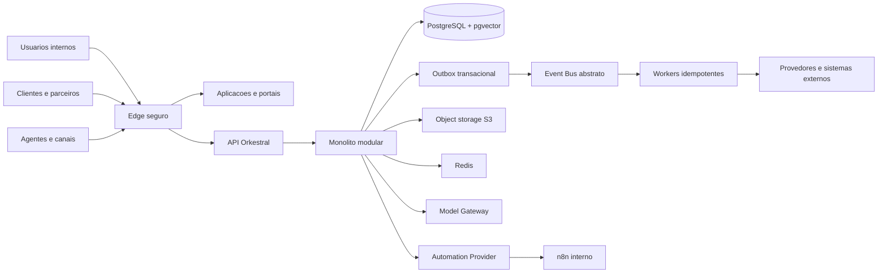
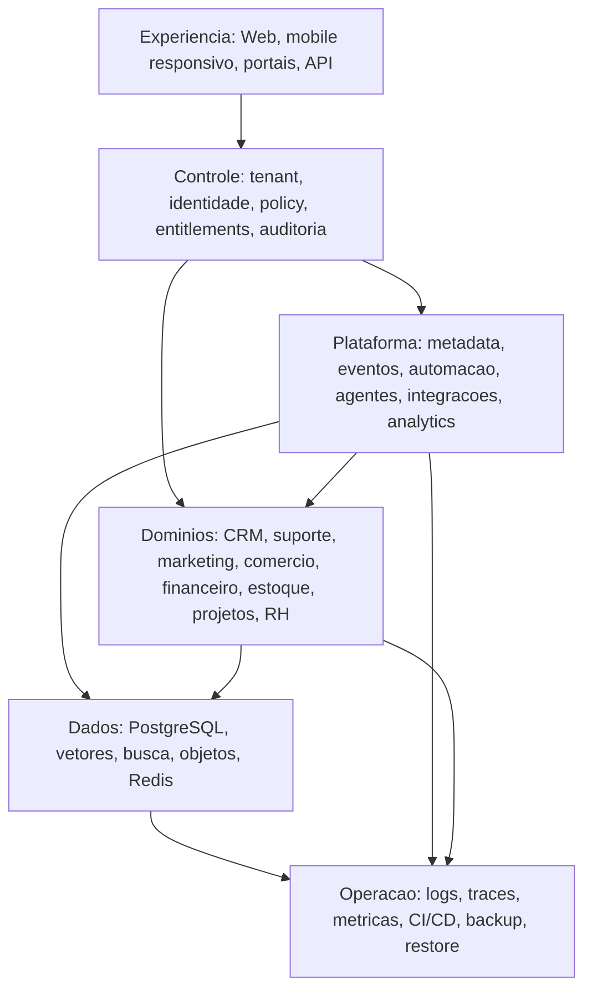
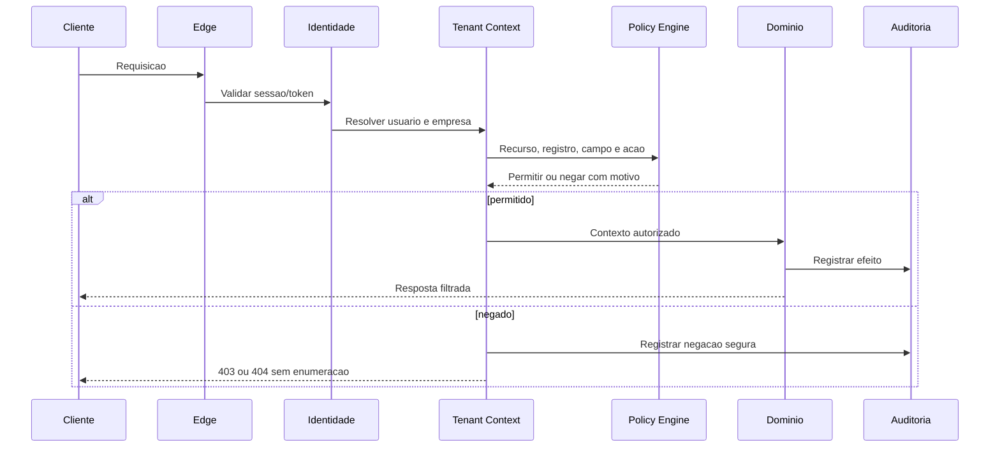
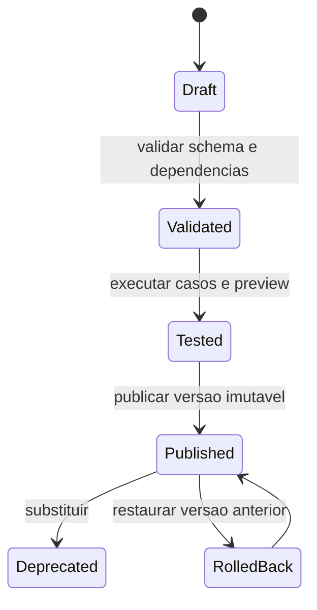
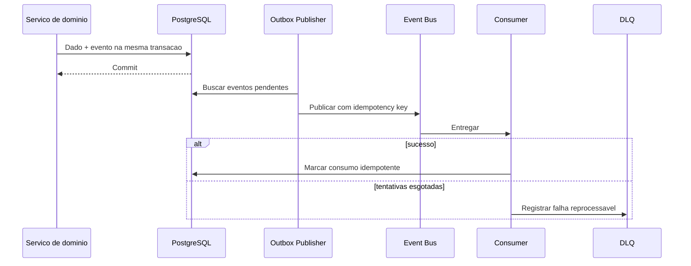

# Arquitetura-alvo empresarial do Orkestral

Versao: 1.0

Data: 21 de julho de 2026.

## Visao

O Orkestral sera um sistema operacional empresarial orientado por metadados, eventos e agentes controlados. A arquitetura preserva o monolito modular enquanto os limites de dominio sao amadurecidos. Separacao em servicos ocorre somente quando carga, risco, disponibilidade ou ciclo de entrega justificarem o custo.

## Principios

1. Tenant e identidade sao resolvidos antes de qualquer dado empresarial.
2. Autorizacao ocorre no backend por objeto, registro, campo e acao.
3. Metadados publicados sao versionados, validados e reversiveis.
4. Eventos saem de transacoes confirmadas por transactional outbox.
5. Agentes usam ferramentas tipadas; nunca acessam o banco diretamente.
6. IA interpreta e planeja; regras deterministicas controlam efeitos.
7. Segredos permanecem em cofre e nunca entram em logs ou prompts.
8. PostgreSQL e a fonte transacional; Redis e acelerador/fila, nao fonte final.
9. n8n e um provedor interno substituivel e invisivel ao cliente.
10. Toda capacidade importante e API-first, observavel e portavel.

## Mapa de contexto

## Camadas logicas

## Nucleo de identidade e seguranca

Componentes:

- `TenantContext`: empresa, usuario, sessao, ambiente e correlation ID.
- `IdentityService`: login, MFA, OIDC, SAML, SCIM e dispositivos por adaptadores.
- `PolicyEngine`: modulo, objeto, registro, campo, acao, ferramenta e documento.
- `EntitlementEngine`: direitos do plano, limites e consumo.
- `CredentialVault`: cifra, rotacao, expiracao, revogacao e acesso auditado.
- `AuditLedger`: eventos de acesso, alteracao, decisao e execucao.
- `DataClassification`: sensibilidade, residencia, retencao e mascaramento.

Fluxo obrigatorio:

## Plataforma de metadados

### Definicoes

- Aplicacao e modulo.
- Entidade, campo e relacionamento.
- Tipo de registro, layout, secao e visualizacao.
- Acao, validacao, formula e valor padrao.
- Permissao, automacao, relatorio e dashboard.
- Pacote, versao e configuracao do tenant.

### Ciclo de vida

O mesmo schema dirige formulario, API, validacao, busca, permissao e evento. JSON e aceito apenas sob contratos Pydantic/JSON Schema versionados; nunca como estrutura sem validacao.

## Plataforma de eventos

### Envelope canonico

- `event_id`.
- `event_type` e `event_version`.
- `company_id`, `actor_user_id` e `environment`.
- `correlation_id` e `causation_id`.
- `occurred_at`.
- `classification` e `retention_policy`.
- `payload` minimo e validado.

### Entrega

Comecar com PostgreSQL, Celery e Redis. A interface permite evoluir para NATS, RabbitMQ ou Kafka sem alterar dominios.

## Runtime de agentes

Componentes:

- Agent Definition e Agent Version.
- Policy, Budget, Schedule e Trigger.
- Tool Registry e Credential Binding.
- Run, Step, Tool Call, Approval e Handoff.
- Memory e Knowledge Source.
- Evaluation Suite, Case, Run e Metric.
- Model Gateway com provedores substituiveis.

```mermaid
flowchart LR
    INPUT["Objetivo autorizado"] --> POLICY["Politica e budget"]
    POLICY --> CONTEXT["Contexto e conhecimento filtrados"]
    CONTEXT --> PLAN["Plano operacional resumido"]
    PLAN --> RISK["Risco por ferramenta"]
    RISK -->|baixo| TOOL["Ferramenta tipada"]
    RISK -->|alto| APPROVAL["Aprovacao humana"]
    APPROVAL --> TOOL
    TOOL --> VALIDATE["Validar resultado real"]
    VALIDATE --> TRACE["Auditoria, custo e metricas"]
    TRACE --> RESULT["Resposta ou handoff"]
```

O trace nao persiste chain-of-thought. Ele registra objetivo, contexto autorizado, plano resumido, ferramentas, argumentos validados, resultados, aprovacoes, erros, custo e duracao.

## Automacao

O Orkestral armazena o workflow canonico. `AutomationProvider` converte e executa em n8n ou outro motor. Blocos possuem schema, versao, risco, permissao, simulacao e contrato de erro.

Recursos obrigatorios:

- draft, validate, simulate, test, publish e rollback;
- idempotencia, timeout, retry, circuit breaker e cancelamento;
- concorrencia, prioridade, espera e agenda;
- aprovacao humana, compensacao, DLQ e replay;
- correlation ID, metricas e logs protegidos.

## Integracoes

`ConnectorDefinition` declara manifesto, autenticacao, schemas, triggers, actions, limites e documentacao. `ConnectorRuntime` executa sob politicas de timeout, retry, rate limit, idempotencia e data egress.

Credenciais sao resolvidas apenas no momento da chamada e entregues ao adaptador em memoria. Respostas e logs passam por redacao antes da persistencia.

## Plataforma de dados

Camadas:

1. Sistema de registro transacional por dominio.
2. Modelo canonico de pessoa, organizacao, identidade e interacao.
3. Ingestao em lote, incremental, eventos e conectores.
4. Qualidade, linhagem, consentimento, retencao e eliminacao.
5. Busca textual, vetorial e filtros de autorizacao.
6. Camada semantica para metricas e dimensoes.
7. Ativacao autorizada para automacoes, analytics e agentes.

Zero-copy nao e promessa universal. Cada fonte informa se os dados sao federados, copiados, cacheados ou materializados.

## Limites dos dominios

| Dominio          | Responsabilidade                    | Nao deve possuir                  |
| ---------------- | ----------------------------------- | --------------------------------- |
| Identidade       | Usuarios, sessoes e provedores      | Regras de CRM                     |
| Empresas         | Tenant, membros e configuracao      | Credenciais externas em texto     |
| Autorizacao      | Papeis, policies e grants           | Logica de tela                    |
| Metadata         | Definicoes e publicacao             | Acesso irrestrito a registros     |
| CRM/Vendas       | Cliente e ciclo comercial           | Faturamento duplicado             |
| Suporte          | Casos, SLA e roteamento             | Copia do cadastro 360             |
| Marketing        | Segmentos, jornadas e consentimento | Envio sem policy de canal         |
| Comercio/Receita | Catalogo, pedido e contrato         | Saldo de estoque paralelo         |
| Financeiro       | Lancamento, conciliacao e caixa     | Execucao autonoma irrestrita      |
| Estoque          | Disponibilidade e rastreabilidade   | Pedido comercial duplicado        |
| Projetos         | Entrega, capacidade e risco         | Cadastro de colaborador duplicado |
| RH               | Jornada e dados de pessoas          | Exposicao ampla de dado sensivel  |
| Analytics        | Semantica, relatorio e dashboard    | Regra transacional principal      |
| Agentes          | Interpretacao e coordenacao         | SQL direto                        |
| Automacoes       | Orquestracao                        | Formato n8n como contrato publico |
| Integracoes      | Conectividade e transformacao       | Regra de negocio do dominio       |

## Implantacao

Modos suportados:

- SaaS compartilhado.
- Nuvem privada dedicada.
- Instalacao empresarial dedicada.
- Hibrido com conectores locais.
- Desenvolvimento local por Docker Compose.

Servicos podem ser extraidos do monolito quando houver um dos gatilhos:

- necessidade de escala independente comprovada;
- fronteira de seguranca ou residencia;
- disponibilidade diferente do restante;
- tecnologia especializada inevitavel;
- equipe e ciclo de release independentes.

## Observabilidade e confiabilidade

Todo request, job, evento, workflow e agent run compartilha correlation ID. Logs incluem ambiente, empresa, usuario, rota, status, duracao, versao e codigo de erro, sempre com redacao.

Metas futuras:

- SLO por API e dominio.
- tracing distribuido.
- metricas por tenant e limites de vizinho ruidoso.
- backup com restore testado.
- RTO/RPO medidos.
- deploy progressivo, rollback e migracao expand/contract.
- runbooks e alertas acionaveis.

## Decisoes que exigem ADR

- Tenant Context e estrategia de RLS.
- Armazenamento de registros personalizados.
- Expression engine de formulas.
- Transactional outbox e broker inicial.
- Envelope de eventos.
- Runtime e versao de agentes.
- Model Gateway e data egress.
- Memoria e retencao.
- Busca vetorial e dimensao de embeddings.
- Package format e assinatura.
- Gateway de APIs.
- Estrategia de sandbox e promocao.

## Proibicoes arquiteturais

- Consulta empresarial sem tenant.
- Autorizacao somente no frontend.
- JSON dinamico sem schema e versao.
- Agente com SQL, segredo ou ferramenta irrestrita.
- Evento publicado antes de commit quando representa efeito transacional.
- Integracao sem timeout, idempotencia e redacao.
- Regra do dominio dentro de rota ou componente de UI.
- Dependencia publica do formato n8n.
- Migracao destrutiva sem expand/contract e rollback.
- Promessa de sucesso sem resultado confirmado.

## Evolucao da Fase 3 - Plataforma de eventos governados

O barramento interno agora separa producao, transporte e consumo. `EventContract` governa payloads; `EventSubscription` descreve destinos; `EventDelivery` controla retentativas e DLQ; `EventConsumption` garante idempotencia. Workflows usam `source_event_id`, sem depender da semantica interna do n8n. A decisao completa esta em `docs/adr/20260721-event-contracts-idempotent-consumers.md`.
