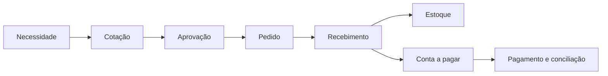

# Plano de reestruturação e aprofundamento da Orkestral

**Data da pesquisa:** 20 de julho de 2026
**Tipo de documento:** estratégia de produto, arquitetura e execução
**Estado:** proposta para orientar as próximas fases
**Fonte normativa relacionada:** `docs/DOCUMENTO_MESTRE.md`

## 1. Resumo executivo

A Orkestral possui uma fundação técnica relevante: SaaS multiempresa, permissões, módulos ativáveis, plugins, cofre de credenciais, n8n, agentes de IA, aprovações humanas, base de conhecimento, construtor de automações, notificações, auditoria, cobrança e implantação remota.

O problema atual não é ausência de componentes. O problema é profundidade de produto. Os módulos empresariais entregam principalmente cadastros, listagens, alterações de estado e resumos. Isso prova a arquitetura, mas ainda não substitui o trabalho diário realizado em plataformas maduras.

A reestruturação deve seguir quatro decisões:

1. Parar de medir progresso pela quantidade de módulos existentes.
2. Medir progresso por jornadas empresariais completas e resultados observáveis.
3. Transformar automações, agentes, dados e aprovações na camada comum de todos os módulos.
4. Reservar a versão `1.0.0` apenas para módulos que cumpram critérios reais de disponibilidade geral.

### Posicionamento recomendado

> A Orkestral é o sistema operacional de empresas de serviços: conecta clientes, equipe, processos, dados, automações e agentes de IA em uma única operação auditável.

O primeiro público recomendado é composto por empresas de serviços com aproximadamente 10 a 200 colaboradores, como agências, consultorias, prestadores B2B, empresas de tecnologia, operações administrativas e negócios com atendimento recorrente.

Essa escolha prioriza CRM, atendimento, projetos, conhecimento, automações, integrações, agentes e análise operacional. Estoque, financeiro e RH permanecem importantes, mas devem evoluir sem tentar reproduzir imediatamente toda a legislação fiscal, contábil e trabalhista de um ERP nacional.

## 2. Diagnóstico atual

### 2.1 Pontos fortes

- Arquitetura multiempresa com isolamento por empresa.
- Controle de acesso por papéis e permissões.
- Catálogo de módulos ativáveis.
- Cofre de credenciais e histórico de testes de conexão.
- Integração com n8n sem remover a definição própria da Orkestral.
- Agentes com ferramentas, conversas, consumo e confirmação humana.
- Base de conhecimento com documentos, páginas web, reindexação e busca.
- Automações com rascunho, validação, publicação, execução, versões e restauração.
- Notificações e aprovações com comentários e decisões.
- Auditoria, exclusão lógica, cobrança e limites.
- Testes automatizados e ambiente remoto de desenvolvimento.

### 2.2 Lacunas principais

- Módulos funcionam como ilhas e compartilham pouco contexto operacional.
- CRM não possui ainda um ciclo comercial completo de lead até receita.
- Marketing define campanhas e jornadas, mas não entrega ativação omnichannel completa.
- Suporte registra chamados, mas não possui operação madura de filas, SLA, portal e roteamento.
- Projetos registra projetos e tarefas, mas não possui planejamento, capacidade, horas e rentabilidade.
- Financeiro registra lançamentos, mas não entrega contas a pagar e receber completas, conciliação e previsões.
- Estoque registra movimentos, mas não entrega compras, fornecedores, lotes, inventário e reposição.
- RH registra colaboradores e ausências, mas não cobre o ciclo do colaborador.
- Analytics registra indicadores, mas não possui camada semântica, conectores, exploração e alertas maduros.
- Faltam campos personalizados, visualizações salvas, comentários, anexos e timeline universal.
- Faltam modelos prontos que levem o cliente do primeiro acesso ao primeiro resultado.
- Algumas telas e versões comunicam maturidade maior do que a capacidade entregue.

### 2.3 Conclusão do diagnóstico

A fundação deve ser preservada. Não é necessário reescrever a plataforma. A mudança principal é evoluir de CRUDs independentes para domínios conectados por eventos, automações, contexto e métricas.

## 3. Pesquisa de mercado

Foram consultadas páginas e documentações oficiais dos produtos abaixo. O objetivo não é copiar interfaces ou regras proprietárias, mas compreender padrões de maturidade.

### 3.1 Odoo

O Odoo organiza uma operação completa em aplicações conectadas: CRM, vendas, assinaturas, faturamento, contabilidade, despesas, documentos, estoque, compras, manutenção, RH, recrutamento, avaliações, marketing, projetos, horas, helpdesk, aprovações e conhecimento.

Fonte oficial: [Odoo All Apps](https://www.odoo.com/page/all-apps)

Lições para a Orkestral:

- Um módulo profundo participa de processos anteriores e posteriores.
- Estoque precisa conversar com compras, vendas e financeiro.
- Projetos precisa conversar com horas, custos, faturamento e suporte.
- RH precisa cobrir o ciclo do colaborador, não somente o cadastro.
- Aplicações integradas valem mais que uma grande quantidade de aplicações isoladas.

### 3.2 ERPNext

O ERPNext combina CRM, contabilidade, estoque, compras, vendas, projetos, helpdesk e RH. Entre as capacidades oficiais estão lotes, números de série, códigos de barras, planejamento de materiais, folha, presença, despesas, oportunidades, cotações, timesheets, rentabilidade e base de conhecimento.

Fonte oficial: [ERPNext Integrated Manufacturing and Business Modules](https://erpnext.com/manufacturing/open-source-integrated-manufacturing-software)

Lições para a Orkestral:

- Cadastros precisam produzir documentos e movimentos de negócio.
- Transações devem ter rastreabilidade financeira e operacional.
- Projetos devem medir prazo, custo e rentabilidade.
- Estoque deve controlar variantes, lote, série, validade e reposição.
- Aprofundar exige relatórios operacionais e não somente cards de resumo.

### 3.3 Zoho One

O Zoho One aposta em uma suíte extensa, interface unificada, contexto compartilhado e interoperabilidade entre aplicações. A empresa destaca fluxos entre apps, automação com serviços externos, análise transversal e mais de mil integrações.

Fonte oficial: [Zoho One Features](https://www.zoho.com/one/features/)

Lições para a Orkestral:

- Dados devem fluir contextualmente entre módulos.
- O usuário não deveria pesquisar o mesmo cliente em várias telas desconectadas.
- Low-code, integrações e painéis precisam utilizar um mesmo modelo de permissões.
- Uma página de contexto deve concentrar todas as informações relacionadas ao objeto atual.

### 3.4 HubSpot

O HubSpot utiliza o CRM como fundação comum para marketing, vendas, atendimento, conteúdo, dados e receita. A oferta madura inclui segmentação avançada, testes A/B, relatórios personalizados, inteligência de conversas, permissões avançadas, roteamento por habilidade, SLA condicional, datasets, conexões com data warehouses, CPQ, cobrança e pagamentos.

Fonte oficial: [HubSpot Enterprise Customer Platform](https://www.hubspot.com/products/crm/enterprise)

Lições para a Orkestral:

- O perfil unificado do cliente deve ser a base da experiência.
- Marketing deve ser medido em oportunidades e receita, não somente envios.
- Atendimento deve conhecer histórico comercial, contratos e projetos.
- Financeiro e comercial devem compartilhar produtos, propostas e cobranças.
- Governança e facilidade de adoção devem crescer junto com os recursos.

### 3.5 Salesforce e Agentforce

O Salesforce conecta dados, metadados, automações, APIs, agentes e aplicações. A plataforma enfatiza governança, observabilidade, segurança e combinação de lógica determinística com raciocínio de IA. Também utiliza templates e ações prontas para acelerar a implantação.

Fonte oficial: [Salesforce Agentforce Platform](https://www.salesforce.com/platform/agentforce-platform/)

Lições para a Orkestral:

- Agentes não podem ser apenas chats com prompt.
- Cada ação de IA precisa de contexto, política, permissão, rastreabilidade e avaliação.
- Regras determinísticas devem controlar ações de alto risco.
- A IA deve operar dentro dos módulos, e não em uma área separada da aplicação.
- Templates de agentes e ações reduzem o tempo até o primeiro valor.

### 3.6 n8n

O n8n separa edição e publicação. Alterações salvas não modificam automaticamente a versão em produção. Subfluxos e fluxos de erro publicados estabilizam composições maiores.

Fontes oficiais: [n8n Workflows](https://docs.n8n.io/workflows/) e [n8n Workflow Publishing](https://support.n8n.io/article/understanding-workflow-publishing-in-n-8-n-2-0)

Lições para a Orkestral:

- Rascunho e versão publicada devem permanecer separados.
- Todo fluxo crítico precisa de tratamento de erro e destino de falhas.
- Subfluxos reutilizáveis evitam duplicação.
- Execuções devem poder ser pesquisadas, inspecionadas, repetidas e comparadas.
- Credenciais devem seguir menor privilégio.

### 3.7 Zendesk

O Zendesk aprofunda atendimento com canais unificados, filas, grupos, capacidade, prioridade, habilidades, risco de violação de SLA e encaminhamento para grupos alternativos.

Fonte oficial: [Zendesk Omnichannel Routing](https://support.zendesk.com/hc/en-us/articles/4409149119514-About-omnichannel-routing)

Lições para a Orkestral:

- Chamado sem fila, SLA e roteamento ainda é somente um registro.
- Distribuição deve considerar disponibilidade, capacidade, prioridade e habilidade.
- A IA deve resolver o simples e transferir o complexo com contexto completo.
- O cliente precisa de portal, histórico e autosserviço.

### 3.8 ClickUp

O ClickUp combina tarefas, sprints, metas, marcos, dependências, comentários, colaboração, dashboards, campos personalizados, automações, várias visualizações e templates.

Fonte oficial: [ClickUp Features](https://clickup.com/features)

Lições para a Orkestral:

- Os mesmos dados devem aparecer em lista, quadro, calendário, timeline e Gantt.
- Comentários e contexto fazem parte da execução do trabalho.
- Metas devem estar ligadas ao trabalho que produz seu progresso.
- Templates reduzem configuração e aumentam adoção.

### 3.9 Power BI

O Power BI separa fonte, modelo semântico, relatório e dashboard. Permite filtros, exploração, drill-down, permissões por linha, atualização e organização em workspaces.

Fontes oficiais: [Power BI Concepts](https://learn.microsoft.com/en-us/power-bi/fundamentals/service-basic-concepts) e [Power BI Row-Level Security](https://learn.microsoft.com/en-us/fabric/security/service-admin-row-level-security)

Lições para a Orkestral:

- Analytics precisa de uma camada semântica, não de consultas específicas por tela.
- Indicadores devem declarar fórmula, fonte, granularidade e atualização.
- O usuário precisa navegar do indicador até os registros que explicam o resultado.
- A segurança do tenant deve alcançar datasets, medidas e exportações.

## 4. O que não deve ser copiado

- Não criar dezenas de aplicações desconectadas apenas para aumentar o catálogo.
- Não reproduzir folha de pagamento e legislação fiscal antes de existir capacidade especializada.
- Não transformar todo dado em uma estrutura genérica EAV difícil de consultar.
- Não permitir que o formato interno do n8n se torne o domínio principal da Orkestral.
- Não prender regras de negócio a um provedor de IA, integração ou hospedagem.
- Não esconder complexidade sem oferecer rastreabilidade.
- Não usar IA para executar ações críticas sem política e confirmação.
- Não declarar um módulo como `1.0.0` somente porque o CRUD está concluído.

## 5. Princípios da nova estrutura

### 5.1 Jornada antes de tela

Cada entrega deve completar uma jornada empresarial observável. Uma lista ou formulário isolado não encerra uma fase.

### 5.2 Dados tipados com extensibilidade controlada

Entidades centrais devem possuir tabelas e regras próprias. Campos personalizados entram como extensão validada, não como substituição do modelo de domínio.

### 5.3 Um objeto, uma timeline

Cliente, oportunidade, chamado, projeto, lançamento, item e colaborador devem possuir histórico único de eventos, comentários, arquivos, automações e decisões.

### 5.4 Automação nativa em todo módulo

Toda alteração relevante deve poder gerar um evento. Toda ação segura deve poder ser chamada por automação ou agente com a mesma autorização utilizada pela interface.

### 5.5 IA governada

Toda ação de agente deve registrar entrada, contexto, ferramentas, modelo, custo, decisão, saída, aprovação e resultado.

### 5.6 Complexidade progressiva

Usuários iniciantes recebem templates e configurações guiadas. Usuários avançados recebem campos, visualizações, automações e políticas configuráveis.

### 5.7 Profundidade mensurável

Um módulo somente avança de maturidade quando possui jornada, permissões, auditoria, testes, métricas, importação, exportação e documentação.

## 6. Arquitetura funcional transversal

Antes de aprofundar todos os módulos separadamente, implementar os componentes compartilhados abaixo.

### 6.1 Perfil empresarial unificado

Criar uma visão única de empresa, contato, fornecedor e colaborador com:

- dados principais;
- relacionamentos;
- timeline;
- e-mails, reuniões e mensagens;
- negócios e propostas;
- chamados;
- projetos;
- cobranças;
- documentos;
- automações;
- consentimentos;
- atividades futuras.

### 6.2 Timeline universal

Criar entidades compartilhadas para:

- atividades;
- comentários;
- menções;
- anexos;
- mudanças de estado;
- eventos de integração;
- execuções de automação;
- ações de agentes;
- decisões humanas.

### 6.3 Campos personalizados

Suportar tipos:

- texto;
- texto longo;
- número;
- moeda;
- porcentagem;
- data e hora;
- seleção simples;
- seleção múltipla;
- usuário;
- empresa;
- contato;
- relacionamento entre registros;
- fórmula controlada.

Critérios obrigatórios:

- validação no backend;
- permissões por campo sensível;
- indexação configurável;
- filtros e ordenação;
- inclusão em importações, exportações e automações;
- histórico de alteração.

### 6.4 Visualizações salvas

Oferecer lista, tabela, quadro, calendário, timeline e Gantt quando aplicável.

Cada visualização deve permitir:

- filtros;
- agrupamentos;
- colunas;
- ordenação;
- compartilhamento;
- definição como padrão;
- escopo pessoal ou da empresa.

### 6.5 Busca global e paleta de comandos

Pesquisar por cliente, contato, oportunidade, chamado, projeto, tarefa, documento, item, colaborador, automação e execução.

A busca deve respeitar empresa, módulo, papel e permissão de campo.

### 6.6 Eventos de domínio

Adotar um catálogo versionado de eventos, por exemplo:

```text
crm.contact.created.v1
crm.opportunity.stage_changed.v1
marketing.campaign.activated.v1
support.ticket.sla_at_risk.v1
projects.task.overdue.v1
inventory.stock.below_minimum.v1
finance.receivable.overdue.v1
hr.leave.approved.v1
knowledge.document.indexed.v1
agent.action.approval_requested.v1
```

Implementar Outbox Pattern para publicar eventos somente após a confirmação da transação no PostgreSQL.

### 6.7 Ações de domínio

Criar um catálogo de ações reutilizável por interface, API, automação e agente:

```text
crm.opportunity.create
crm.opportunity.advance
marketing.campaign.enroll_contact
support.ticket.assign
support.ticket.respond
projects.task.create
inventory.transfer.create
finance.receivable.settle
hr.leave.decide
```

Cada ação deve declarar:

- permissão;
- esquema de entrada;
- esquema de saída;
- idempotência;
- risco;
- necessidade de confirmação;
- eventos emitidos;
- limite de execução;
- dados auditados.

### 6.8 Caixa de trabalho unificada

Centralizar:

- tarefas atribuídas;
- aprovações;
- chamados aguardando resposta;
- SLAs em risco;
- automações com falha;
- documentos pendentes;
- alertas de indicadores;
- ações recomendadas por IA.

### 6.9 Importação, exportação e qualidade

Criar um assistente comum com:

- CSV e XLSX;
- mapeamento de colunas;
- pré-visualização;
- validação por linha;
- importação idempotente;
- detecção de duplicados;
- relatório de erros;
- rollback do lote;
- exportação respeitando permissões;
- execução em background.

## 7. Reestruturação por módulo

## 7.1 CRM e Vendas

### Objetivo

Transformar contatos e etiquetas em um ciclo comercial completo e na fonte de contexto do cliente.

### Entidades novas ou aprofundadas

- contas e organizações;
- contatos;
- leads;
- oportunidades;
- pipelines;
- etapas;
- atividades;
- produtos e serviços;
- propostas;
- itens de proposta;
- motivos de perda;
- metas e previsões;
- formulários de captura;
- consentimentos.

### Prioridade P0

- Pipeline visual configurável.
- Conversão de lead em contato, empresa e oportunidade.
- Timeline completa do cliente.
- Tarefas, ligações, reuniões e notas.
- Campos personalizados.
- Pesquisa, filtros e visualizações salvas.
- Detecção e mesclagem de duplicados.
- Importação e exportação.
- Regras de responsável e distribuição.
- Permissões por equipe e carteira.

### Prioridade P1

- Sincronização de e-mail e calendário.
- Formulários públicos com proteção antispam.
- Catálogo de produtos e serviços.
- Propostas com versionamento e aprovação.
- Sequências comerciais.
- Previsão de receita ponderada.
- Metas por usuário, equipe e período.
- Portal para aceite de proposta.

### Prioridade P2

- Lead scoring configurável.
- Inteligência de conversas.
- Próxima melhor ação sugerida por IA.
- Territórios comerciais.
- Renovação e expansão de clientes.

### Automações de referência

- Novo formulário cria lead, elimina duplicidade e distribui responsável.
- Oportunidade parada gera tarefa e notifica o gestor.
- Proposta aprovada cria projeto e previsão financeira.
- Negócio perdido registra motivo e inicia nutrição.

### Indicadores

- leads por origem;
- taxa de conversão por etapa;
- tempo médio por etapa;
- ciclo de venda;
- valor do pipeline;
- previsão ponderada;
- receita ganha;
- motivos de perda;
- atividades por vendedor.

### Critério de maturidade

Um usuário deve conseguir receber um lead, qualificá-lo, conduzir uma oportunidade, emitir uma proposta, obter aprovação e gerar o início da entrega sem utilizar planilhas.

## 7.2 Marketing

### Objetivo

Transformar campanhas e jornadas em aquisição, nutrição, conversão e atribuição mensuráveis.

### Entidades novas ou aprofundadas

- segmentos dinâmicos;
- consentimentos;
- listas de supressão;
- templates;
- remetentes;
- canais;
- campanhas;
- variantes;
- eventos de engajamento;
- jornadas;
- inscrições;
- conversões;
- parâmetros UTM;
- custos;
- modelos de atribuição.

### Prioridade P0

- Segmentação por dados do CRM e comportamento.
- Consentimento, opt-in, opt-out e supressão.
- Editor e biblioteca de templates.
- Campanhas de e-mail por adaptador.
- Agendamento e controle de fuso horário.
- Eventos de envio, entrega, abertura, clique, rejeição e cancelamento.
- Jornada com condições, espera e saída.
- Painel de desempenho por campanha.

### Prioridade P1

- WhatsApp por provedor oficial.
- SMS por adaptador.
- Testes A/B.
- Frequência máxima por contato.
- Formulários e landing pages.
- Lead scoring por engajamento.
- Atribuição de oportunidade e receita.
- Orçamento e custo por conversão.

### Prioridade P2

- Otimização de horário por IA.
- Geração de conteúdo com aprovação humana.
- Segmentos preditivos.
- Recomendação de próxima campanha.
- Otimização automática dentro de limites configurados.

### Automações de referência

- Lead baixa material e entra em nutrição.
- Clique em oferta aumenta score e cria tarefa comercial.
- Ausência de engajamento move contato para segmento de reativação.
- Oportunidade ganha encerra comunicações de prospecção.

### Indicadores

- entrega;
- abertura;
- clique;
- rejeição;
- descadastro;
- conversão;
- custo por lead;
- custo por oportunidade;
- receita atribuída;
- retorno por campanha.

### Critério de maturidade

Uma campanha deve sair de um segmento do CRM, percorrer uma jornada real, gerar eventos rastreáveis e provar sua contribuição para oportunidades e receita.

## 7.3 Suporte e Sucesso do Cliente

### Objetivo

Transformar tickets e interações em uma operação omnichannel com SLA, roteamento, autosserviço e visão de saúde do cliente.

### Entidades novas ou aprofundadas

- canais;
- caixas de entrada;
- filas;
- grupos;
- habilidades;
- capacidade;
- políticas de SLA;
- calendários de atendimento;
- tickets;
- conversas;
- macros;
- motivos de contato;
- satisfação;
- portal;
- contratos de atendimento;
- indicadores de saúde.

### Prioridade P0

- Filas e caixas de entrada.
- SLA de primeira resposta e resolução.
- Calendário comercial e feriados.
- Roteamento manual, round-robin e por carga.
- Prioridade, categoria, tags e responsável.
- Respostas públicas e notas internas.
- Timeline do cliente.
- Macros e respostas prontas.
- Alertas de SLA em risco.
- CSAT ao encerrar.

### Prioridade P1

- Entrada por e-mail.
- Widget web e portal do cliente.
- WhatsApp por provedor oficial.
- Roteamento por habilidade e prioridade.
- Escalonamento e grupos alternativos.
- Base de conhecimento sugerida durante a resposta.
- Relatórios de fila, agente, tema e cliente.
- Playbooks de sucesso e risco de churn.

### Prioridade P2

- Classificação automática de intenção e sentimento.
- Resumo de conversa.
- Resposta sugerida com citação da base.
- Agente de IA com transferência para humano.
- Previsão de risco de violação de SLA.
- Auditoria de qualidade do atendimento.

### Automações de referência

- Ticket urgente entra na fila prioritária e alerta plantão.
- SLA em risco escala para gestor.
- Ticket recorrente cria problema e artigo sugerido.
- Cliente insatisfeito cria tarefa de recuperação.

### Indicadores

- primeira resposta;
- tempo de resolução;
- cumprimento de SLA;
- reabertura;
- backlog;
- ocupação por agente;
- transferência;
- CSAT;
- resolução pela IA;
- desvio por autosserviço.

### Critério de maturidade

Uma solicitação deve entrar por um canal, ser roteada, atendida dentro de SLA, consultar conhecimento, preservar o contexto do cliente e produzir avaliação e indicadores.

## 7.4 Projetos e Entrega

### Objetivo

Transformar projetos e tarefas em planejamento, colaboração, capacidade, custo e rentabilidade.

### Entidades novas ou aprofundadas

- programas;
- projetos;
- fases;
- marcos;
- tarefas e subtarefas;
- dependências;
- riscos;
- decisões;
- horas;
- capacidade;
- orçamento;
- despesas;
- entregáveis;
- templates;
- baselines.

### Prioridade P0

- Hierarquia de projeto, fase, tarefa e subtarefa.
- Quadro, lista, calendário e timeline.
- Dependências e marcos.
- Comentários, menções e anexos.
- Campos personalizados.
- Templates de projeto.
- Progresso calculado.
- Tarefas recorrentes.
- Alertas de atraso.

### Prioridade P1

- Gantt.
- Registro e aprovação de horas.
- Capacidade e carga por pessoa.
- Orçamento, custo previsto e custo realizado.
- Portal do cliente.
- Aprovação de entregáveis.
- Riscos, impedimentos e decisões.
- Faturamento por marco, mensalidade ou hora.

### Prioridade P2

- Planejamento assistido por IA.
- Resumo automático de status.
- Previsão de atraso.
- Sugestão de redistribuição de capacidade.
- Rentabilidade prevista por projeto.

### Automações de referência

- Oportunidade ganha cria projeto a partir de template.
- Marco aprovado gera cobrança.
- Tarefa crítica atrasada alerta gestor e cliente conforme política.
- Projeto encerrado cria pesquisa e retrospectiva.

### Indicadores

- avanço;
- prazo;
- tarefas atrasadas;
- horas previstas e realizadas;
- utilização;
- custo;
- margem;
- riscos abertos;
- satisfação do cliente.

### Critério de maturidade

Um gestor deve conseguir planejar, distribuir, acompanhar, aprovar e medir a rentabilidade de uma entrega sem utilizar ferramentas externas de projeto.

## 7.5 Estoque, Compras e Operações

### Objetivo

Transformar itens e movimentos em um processo rastreável de suprimento, armazenamento, transferência, consumo e reposição.

### Entidades novas ou aprofundadas

- produtos;
- variantes e SKUs;
- unidades de medida;
- fornecedores;
- armazéns e endereços;
- lotes;
- números de série;
- validade;
- listas de preço;
- cotações de compra;
- pedidos de compra;
- recebimentos;
- transferências;
- ajustes;
- reservas;
- inventários;
- regras de reposição.

### Prioridade P0

- Produto, variante e SKU.
- Unidade de medida.
- Múltiplos armazéns e endereços.
- Entrada, saída, transferência e ajuste.
- Saldo disponível, reservado e projetado.
- Estoque mínimo e ponto de reposição.
- Inventário com contagem e divergência.
- Histórico imutável de movimentos.

### Prioridade P1

- Fornecedores e condições comerciais.
- Solicitação e pedido de compra.
- Recebimento parcial.
- Lotes, série e validade.
- Código de barras por câmera.
- Reserva para projeto ou pedido.
- Custo médio e custo por lote.
- Sugestão de compra.

### Prioridade P2

- Aprovação de compras.
- Comparação de fornecedores.
- Curva ABC.
- Previsão de demanda.
- Reposição automática com limites.
- Integração com vendas, projetos e manutenção.

### Automações de referência

- Estoque projetado abaixo do mínimo cria sugestão de compra.
- Lote próximo da validade alerta responsável.
- Projeto aprovado reserva materiais.
- Recebimento atualiza estoque e cria obrigação financeira.

### Indicadores

- giro;
- cobertura;
- ruptura;
- estoque parado;
- divergência de inventário;
- prazo de fornecedor;
- compras em atraso;
- custo por item;
- perdas por validade.

### Critério de maturidade

Um item deve ser rastreado desde a necessidade de compra até recebimento, armazenamento, reserva, consumo e impacto financeiro.

## 7.6 Financeiro Operacional

### Objetivo

Transformar lançamentos em controle de caixa, contas a pagar, contas a receber, conciliação, orçamento e rentabilidade.

### Limite estratégico

A primeira versão profunda não deve prometer contabilidade fiscal completa. Obrigações fiscais, emissão fiscal e contabilidade oficial devem utilizar integrações e parceiros especializados até existir equipe de domínio.

### Entidades novas ou aprofundadas

- plano gerencial de contas;
- centros de custo;
- contas bancárias;
- clientes e fornecedores;
- contas a receber;
- contas a pagar;
- parcelas;
- pagamentos;
- recebimentos;
- recorrências;
- conciliações;
- orçamentos;
- projeções;
- rateios;
- anexos e comprovantes.

### Prioridade P0

- Contas a pagar e receber.
- Parcelamento e recorrência.
- Situações de vencimento, atraso, pagamento e cancelamento.
- Centros de custo e projetos.
- Fluxo de caixa realizado e projetado.
- Anexos e comprovantes.
- Aprovação por valor e categoria.
- Importação bancária CSV/OFX quando aplicável.

### Prioridade P1

- Conciliação bancária assistida.
- Orçamentos e limites.
- Rateios.
- Cobrança e links de pagamento por provedor.
- Régua de cobrança.
- Faturamento de projetos e contratos.
- DRE gerencial.
- Rentabilidade por cliente, projeto e serviço.

### Prioridade P2

- Previsão de inadimplência.
- Previsão de caixa.
- Detecção de anomalias.
- Sugestão de conciliação por IA.
- Integração fiscal e contábil por adaptadores.

### Automações de referência

- Proposta aceita cria previsão de recebimento.
- Marco aprovado gera conta a receber.
- Vencimento próximo dispara lembrete.
- Atraso inicia régua de cobrança.
- Pagamento conciliado atualiza cliente e projeto.

### Indicadores

- saldo;
- caixa projetado;
- contas vencidas;
- inadimplência;
- prazo médio de recebimento;
- prazo médio de pagamento;
- orçamento versus realizado;
- margem por cliente;
- margem por projeto.

### Critério de maturidade

O gestor deve compreender o caixa presente e futuro, controlar obrigações, receber alertas, aprovar gastos e relacionar receita e custo aos clientes e projetos correspondentes.

## 7.7 Recursos Humanos

### Objetivo

Transformar colaboradores e ausências em um ciclo completo de entrada, desenvolvimento, operação e saída.

### Limite estratégico

Folha de pagamento oficial e obrigações trabalhistas devem começar por integração com provedores especializados. A Orkestral mantém os eventos, aprovações, documentos e contexto operacional.

### Entidades novas ou aprofundadas

- cargos;
- posições;
- departamentos;
- colaboradores;
- gestores;
- contratos;
- documentos;
- admissões;
- checklists;
- férias e ausências;
- jornadas e ponto;
- competências;
- metas;
- avaliações;
- vagas;
- candidatos;
- desligamentos;
- ativos atribuídos.

### Prioridade P0

- Estrutura organizacional.
- Perfil do colaborador com documentos protegidos.
- Admissão e desligamento por checklist.
- Férias, ausências, saldo e aprovação.
- Calendário da equipe.
- Campos sensíveis com permissão específica.
- Portal do colaborador.

### Prioridade P1

- Recrutamento e pipeline de candidatos.
- Controle de jornada ou integração de ponto.
- Despesas e reembolsos integrados ao financeiro.
- Metas e avaliações.
- Competências e treinamentos.
- Ativos e acessos atribuídos.
- Integração com folha.

### Prioridade P2

- Plano de desenvolvimento.
- Pesquisa de clima.
- Risco de rotatividade com uso responsável de IA.
- Planejamento de sucessão.
- Recomendações de treinamento.

### Automações de referência

- Admissão cria usuário, acessos, tarefas e solicitações de equipamento.
- Férias aprovadas atualizam calendário e capacidade dos projetos.
- Desligamento revoga acessos e inicia checklist auditável.
- Avaliação concluída cria plano de desenvolvimento.

### Indicadores

- quadro atual;
- admissões e desligamentos;
- rotatividade;
- ausências;
- férias pendentes;
- tempo de contratação;
- conclusão de onboarding;
- carga por equipe;
- evolução de metas.

### Critério de maturidade

RH e gestor devem executar admissão, operação, ausências, desenvolvimento e desligamento com segregação de dados sensíveis e trilha completa.

## 7.8 Analytics e Gestão por Indicadores

### Objetivo

Transformar indicadores manuais em uma camada analítica confiável, explorável e acionável.

### Entidades novas ou aprofundadas

- fontes de dados;
- datasets;
- dimensões;
- medidas;
- relações;
- regras de atualização;
- dashboards;
- páginas;
- widgets;
- filtros;
- metas;
- alertas;
- assinaturas de relatório;
- linhagem;
- certificação.

### Prioridade P0

- Dicionário de métricas.
- Medidas com fórmula, unidade, proprietário e fonte.
- Dashboards por módulo.
- Filtros por período, equipe, responsável e situação.
- Drill-down do indicador para registros.
- Metas, faixas e alertas.
- Atualização e indicação de frescor.
- Permissão por empresa e papel.

### Prioridade P1

- Construtor de dashboard.
- Widgets reutilizáveis.
- Visualizações salvas.
- Comparação entre períodos.
- Relatórios agendados.
- Exportação CSV, XLSX e PDF.
- Datasets externos por conector.
- Linhagem da métrica até a origem.

### Prioridade P2

- Perguntas em linguagem natural.
- Detecção de anomalias.
- Previsões.
- Narrativas automáticas.
- Recomendação de ação vinculada a automações.

### Automações de referência

- Indicador abaixo da meta cria plano de ação.
- SLA em deterioração alerta gestor.
- Margem abaixo do limite bloqueia proposta sem aprovação.
- Estoque parado inicia campanha ou sugestão comercial.

### Critério de maturidade

Todo número relevante deve informar origem, fórmula, atualização, permissões e registros que o explicam. Um alerta deve poder iniciar uma ação ou automação.

## 7.9 Automações

### Objetivo

Transformar o construtor atual em uma plataforma confiável de execução empresarial.

### Prioridade P0

- Catálogo versionado de gatilhos e ações.
- Rascunho separado da versão publicada.
- Validação estrutural e semântica.
- Teste com dados simulados.
- Histórico detalhado de execução.
- Busca por status, período, objeto e erro.
- Tentativas com backoff.
- Idempotência.
- Timeout por etapa.
- Fluxo de erro.
- Fila de falhas.
- Reexecução total ou a partir de etapa segura.

### Prioridade P1

- Subfluxos reutilizáveis.
- Variáveis e segredos por ambiente.
- Comparação visual de versões.
- Aprovação antes da publicação.
- Calendário e agendamento avançado.
- Limites de concorrência.
- Controle de taxa por integração.
- Templates por caso de uso.
- Métricas de confiabilidade e economia.

### Prioridade P2

- Sugestão de fluxo por linguagem natural.
- Diagnóstico de falha por IA.
- Otimização de caminhos.
- Simulação de impacto.
- Marketplace de templates e blocos.

### Critério de maturidade

Uma automação crítica deve possuir versão publicada imutável, observabilidade, política de erro, idempotência, reexecução segura e responsável identificável.

## 7.10 Agentes de IA

### Objetivo

Transformar agentes configuráveis em trabalhadores digitais governados, especializados e mensuráveis.

### Entidades novas ou aprofundadas

- versões de agente;
- objetivos;
- instruções;
- políticas;
- ferramentas;
- escopos;
- memórias;
- conjuntos de avaliação;
- execuções;
- etapas de raciocínio seguro;
- aprovações;
- resultados;
- feedback;
- custos;
- limites.

### Prioridade P0

- Versionamento de prompt, ferramentas e políticas.
- Escopo por empresa e função.
- Limites de custo e duração.
- Rastreio de chamadas de ferramenta.
- Aprovação por nível de risco.
- Citações da base de conhecimento.
- Fallback para humano.
- Avaliações antes da publicação.
- Logs seguros e redigidos.

### Prioridade P1

- Memória por cliente e processo com retenção controlada.
- Agentes especializados por módulo.
- Delegação entre agentes com política.
- Ambiente de simulação.
- Comparação entre versões e modelos.
- Métricas de qualidade, resolução e custo.
- Templates de agentes.

### Prioridade P2

- Planejamento híbrido determinístico e adaptativo.
- Seleção automática de modelo dentro de política.
- Otimização de custo e latência.
- Avaliação contínua com amostras reais anonimizadas.
- Marketplace privado de agentes.

### Agentes de referência

- Qualificador comercial.
- Assistente de atendimento.
- Analista de operação.
- Coordenador de projeto.
- Cobrador assistido.
- Assistente de RH.
- Curador de conhecimento.

### Critério de maturidade

Um agente publicado deve possuir objetivo, ferramentas mínimas, avaliação aprovada, política de risco, limite de custo, observabilidade, fallback e indicador de resultado.

## 7.11 Conhecimento

### Objetivo

Transformar documentos indexados em uma fonte confiável, atualizada, autorizada e citável para pessoas, automações e agentes.

### Prioridade P0

- Coleções e escopos de acesso.
- Upload e importação web.
- Extração, divisão e indexação.
- `pgvector` como padrão inicial de vetores.
- Busca híbrida textual e vetorial.
- Citações com trecho, documento e página.
- Estado de processamento e diagnóstico.
- Reindexação segura.
- Exclusão completa de vetores relacionados.

### Prioridade P1

- Sincronização com Google Drive, Notion, sites e armazenamento S3.
- Agendamento de atualização.
- Detecção de conteúdo alterado.
- Versionamento de documento.
- Metadados e filtros.
- Feedback de relevância.
- Conteúdo aprovado e conteúdo em revisão.
- Artigos públicos para suporte.

### Prioridade P2

- Sugestão de lacunas de conteúdo.
- Detecção de contradições.
- Curadoria assistida.
- Avaliação de recuperação por conjunto de perguntas.
- Respostas multilíngues preservando a fonte.

### Critério de maturidade

Toda resposta baseada em conhecimento deve ser autorizada, citável, reproduzível e ligada à versão da fonte utilizada.

## 7.12 Integrações e Plugins

### Objetivo

Transformar credenciais e testes de conexão em conectores operacionais governados.

### Prioridade P0

- OAuth 2.0 quando disponível.
- API key e credenciais com menor privilégio.
- Escopos declarados.
- Teste de conexão.
- Webhooks assinados.
- Sincronização incremental.
- Mapeamento de campos.
- Controle de taxa.
- Tentativas e fila de falhas.
- Observabilidade por conector.

### Prioridade P1

- SDK de conectores.
- Ciclo de vida e versionamento.
- Importação inicial e sincronização contínua.
- Resolução de conflitos.
- Tela de saúde da integração.
- Rotação de credenciais.
- Templates de automação por integração.

### Conectores prioritários

1. E-mail via Microsoft e Google.
2. Calendários Microsoft e Google.
3. WhatsApp por API oficial.
4. Webhooks e HTTP genérico.
5. Stripe ou provedor equivalente para pagamentos.
6. Google Drive e armazenamento S3.
7. Slack ou Microsoft Teams.
8. GitHub.
9. Contabilidade, fiscal e folha por parceiros adequados ao Brasil.

### Critério de maturidade

Um conector deve possuir autenticação segura, escopos, sincronização idempotente, histórico, alertas, política de erro e documentação de desligamento.

## 7.13 Administração, Planos e Governança

### Objetivo

Dar ao administrador controle seguro sobre empresa, usuários, dados, consumo, ambientes e políticas.

### Prioridade P0

- Convites e ciclo de usuário.
- Equipes e grupos.
- Papéis e permissões granulares.
- Sessões e dispositivos.
- Políticas de retenção.
- Exportação da empresa.
- Auditoria pesquisável.
- Limites por plano.
- Medição por recurso.
- Central de saúde dos serviços.

### Prioridade P1

- SSO por OIDC e SAML conforme demanda.
- SCIM conforme demanda enterprise.
- IP allowlist.
- Permissões por campo.
- Políticas de aprovação configuráveis.
- Ambientes de teste e produção.
- Sandbox de automações.
- Impersonação administrativa auditada.

### Critério de maturidade

O administrador deve entender quem acessou, o que mudou, quanto foi consumido, quais integrações estão saudáveis e como exportar ou remover os dados da empresa.

## 8. Jornadas integradas obrigatórias

A próxima geração da Orkestral deve ser entregue pelas jornadas abaixo.

## 8.1 Lead até receita


## 8.2 Campanha até receita


## 8.3 Chamado até resolução


## 8.4 Projeto até rentabilidade


## 8.5 Compra até pagamento



## 8.6 Admissão até desligamento


## 9. Reestruturação da experiência

### 9.1 Página inicial por papel

O dashboard inicial deve mudar conforme a função:

| Papel        | Conteúdo prioritário                                 |
| ------------ | ---------------------------------------------------- |
| Proprietário | receita, caixa, pipeline, projetos, riscos e alertas |
| Comercial    | leads, oportunidades, tarefas, metas e propostas     |
| Marketing    | campanhas, segmentos, conversões e atribuição        |
| Atendimento  | filas, SLA, tickets, satisfação e sugestões          |
| Projetos     | entregas, atrasos, capacidade, horas e margem        |
| Financeiro   | vencimentos, caixa, conciliação e aprovações         |
| RH           | admissões, ausências, documentos e ações pendentes   |
| Operações    | estoque, compras, movimentos e rupturas              |

### 9.2 Navegação

- Menu lateral fixo e recolhível.
- Favoritos por usuário.
- Itens recentes.
- Busca global.
- Paleta de comandos.
- Caixa de trabalho unificada.
- Troca de empresa sempre visível.
- Indicador de ambiente de desenvolvimento.
- Recursos indisponíveis ocultos ou explicados comercialmente.

### 9.3 Páginas de registro

Toda página de registro deve seguir uma estrutura previsível:

1. cabeçalho com identidade, estado e ações;
2. resumo executivo;
3. propriedades principais;
4. relacionamentos;
5. timeline;
6. tarefas e próximas ações;
7. arquivos;
8. automações e agentes relacionados;
9. auditoria conforme permissão.

### 9.4 Onboarding orientado a resultado

O primeiro acesso deve perguntar o objetivo principal da empresa e oferecer templates.

Templates iniciais:

- captar e qualificar leads;
- atender clientes com SLA;
- entregar projetos de serviço;
- cobrar clientes inadimplentes;
- aprovar férias;
- repor estoque mínimo;
- responder usando a base de conhecimento.

## 10. Arquitetura técnica recomendada

### 10.1 Preservar o monólito modular

Não dividir prematuramente em microsserviços. Manter FastAPI e PostgreSQL como monólito modular, com limites de domínio explícitos.

Separar quando existirem evidências de necessidade:

- processamento de documentos;
- execução de automações;
- notificações de alto volume;
- analytics pesado;
- conectores específicos.

### 10.2 Limites de domínio

Cada módulo deve possuir:

- modelos;
- schemas;
- serviços de aplicação;
- políticas;
- repositórios ou acesso a dados controlado;
- eventos;
- ações;
- rotas;
- testes;
- migrações.

Um módulo não deve alterar diretamente tabelas internas de outro módulo. A interação ocorre por serviços públicos, ações ou eventos.

### 10.3 Persistência e multiempresa

- Manter `company_id` em todas as entidades de tenant.
- Adicionar PostgreSQL Row-Level Security como defesa adicional em áreas críticas.
- Criar índices compostos iniciados por `company_id` para consultas frequentes.
- Usar identificadores idempotentes em integrações.
- Usar exclusão lógica quando retenção e auditoria exigirem.
- Definir política de purge para dados que devem ser eliminados.

### 10.4 APIs

- Paginação cursor-based em listas extensas.
- Filtros, ordenação e seleção de campos padronizados.
- `Idempotency-Key` em comandos externos.
- Concorrência otimista por versão do registro.
- Problem Details para erros.
- Contratos OpenAPI versionados.
- Webhooks assinados e versionados.
- Limites por tenant e endpoint.

### 10.5 Jobs e eventos

- Outbox transacional.
- Fila com tentativas e backoff.
- Dead-letter queue.
- Chave de idempotência.
- Lock distribuído quando necessário.
- Métricas de fila, atraso, tentativa e falha.
- Reprocessamento administrativo seguro.

### 10.6 Analytics

Começar com PostgreSQL e views/materialized views por domínio. Introduzir armazenamento analítico separado somente quando volume e latência justificarem.

### 10.7 Vetores

Padronizar `pgvector` como armazenamento vetorial inicial. Manter uma interface de repositório para permitir migração futura sem alterar regras de conhecimento e agentes.

### 10.8 n8n

A Orkestral permanece proprietária de:

- definição do fluxo;
- versão;
- permissões;
- publicação;
- auditoria;
- catálogo de blocos;
- política de execução;
- histórico empresarial.

O n8n funciona como adaptador de execução. A tradução deve ser versionada, testada por fixtures e compatível com versões declaradas do n8n.

## 11. Segurança, governança e confiabilidade

### 11.1 Controles obrigatórios

- RBAC e políticas contextuais.
- Permissão por campo sensível.
- RLS em dados críticos.
- Cofre de credenciais.
- Criptografia em trânsito e repouso.
- Redação de logs.
- Auditoria imutável de ações críticas.
- Sessões e dispositivos.
- Rate limit por usuário, empresa e integração.
- Aprovação para ações de risco.
- Proteção contra prompt injection em ferramentas de agentes.
- Restrições de egress para conectores e agentes.

### 11.2 Classificação de risco de ações

| Nível   | Exemplo                                                   | Comportamento                                      |
| ------- | --------------------------------------------------------- | -------------------------------------------------- |
| Baixo   | consultar dados autorizados                               | execução automática                                |
| Médio   | criar tarefa ou rascunho                                  | execução com auditoria e possibilidade de desfazer |
| Alto    | enviar mensagem externa ou alterar estado financeiro      | confirmação conforme política                      |
| Crítico | excluir dados, pagar, cancelar contrato ou revogar acesso | dupla confirmação ou aprovação segregada           |

### 11.3 SLOs iniciais

| Capacidade                            | Meta inicial                             |
| ------------------------------------- | ---------------------------------------- |
| API interativa P95                    | menor que 500 ms em operações comuns     |
| Disponibilidade futura de produção    | 99,9% conforme infraestrutura contratada |
| Evento até automação                  | menor que 10 segundos em carga normal    |
| Falha silenciosa em automação crítica | zero                                     |
| Rastreabilidade de ação crítica       | 100%                                     |
| Isolamento multiempresa               | 100% dos testes aprovados                |

## 12. Estratégia de testes

Cada módulo aprofundado deve entregar:

- testes unitários de regras;
- testes de autorização;
- testes multiempresa;
- testes de integração com PostgreSQL e Redis;
- testes de contrato de conectores;
- testes de migração;
- testes E2E da jornada;
- testes de idempotência;
- testes de concorrência;
- testes de acessibilidade;
- testes de desempenho dos endpoints críticos;
- testes de recuperação de falha;
- testes de regressão visual das telas principais.

## 13. Modelo de maturidade dos módulos

| Nível                 | Versão sugerida | Critério                                                      |
| --------------------- | --------------- | ------------------------------------------------------------- |
| Protótipo             | `0.1.x`         | fluxo demonstrável, sem promessa operacional                  |
| Alpha                 | `0.2.x`         | regras principais e dados reais, uso interno                  |
| Beta                  | `0.5.x`         | jornada principal completa, integrações limitadas             |
| Release Candidate     | `0.9.x`         | segurança, migração, observabilidade e documentação completas |
| Disponibilidade geral | `1.0.0`         | critérios funcionais e não funcionais aprovados para clientes |

### Critérios para `1.0.0`

- Jornada principal completa.
- Permissões e isolamento multiempresa.
- Auditoria.
- Importação e exportação.
- Pesquisa e filtros.
- Eventos e ações de automação.
- Documentação para usuário e administrador.
- Métricas operacionais.
- Testes unitários, integração e E2E.
- Migração e rollback documentados.
- Monitoramento.
- Desempenho validado.
- Ausência de placeholders de fase ou linguagem interna.

Recomendação imediata: reclassificar os módulos atuais como `Beta 0.5.0` até que cumpram esses critérios.

## 14. Plano de execução

As durações abaixo são faixas de planejamento, não promessas. Consideram desenvolvimento sequencial com validação contínua. Um time pequeno pode paralelizar domínios independentes depois da fundação transversal.

## Onda 0 - Verdade do produto e foco

**Duração estimada:** 2 a 3 semanas

Entregas:

- Definir público inicial e casos de uso prioritários.
- Reclassificar maturidade dos módulos.
- Remover linguagem de fase das telas de clientes.
- Definir métricas North Star.
- Transformar este plano em épicos e ADRs.
- Mapear débitos e migrações.

Saída obrigatória: roadmap aprovado e backlog priorizado por jornada.

## Onda 1 - Fundação transversal

**Duração estimada:** 5 a 7 semanas

Entregas:

- Timeline universal.
- Comentários, menções e anexos.
- Campos personalizados.
- Visualizações salvas.
- Busca global.
- Caixa de trabalho.
- Eventos e Outbox Pattern.
- Catálogo de ações.
- Importação e exportação comuns.

Saída obrigatória: os módulos podem compartilhar contexto sem acoplamento direto.

## Onda 2 - CRM, vendas e primeira jornada completa

**Duração estimada:** 6 a 8 semanas

Entregas:

- Pipeline comercial.
- Leads e oportunidades.
- Atividades.
- Produtos e propostas.
- Formulários.
- Previsão.
- Jornada lead até projeto e cobrança prevista.

Saída obrigatória: lead até receita prevista funcionando de ponta a ponta.

## Onda 3 - Automações e integrações confiáveis

**Duração estimada:** 5 a 7 semanas

Entregas:

- Catálogo versionado.
- Subfluxos.
- Política de erro.
- Fila de falhas.
- Idempotência.
- Reexecução.
- OAuth.
- E-mail, calendário, webhooks e WhatsApp inicial.

Saída obrigatória: automações críticas operáveis e diagnosticáveis.

## Onda 4 - Atendimento e conhecimento

**Duração estimada:** 5 a 7 semanas

Entregas:

- Filas.
- SLA.
- Roteamento.
- Portal.
- E-mail e widget.
- CSAT.
- Sugestões da base.
- Agente com transferência humana.

Saída obrigatória: chamado até resolução completo.

## Onda 5 - Projetos e rentabilidade

**Duração estimada:** 5 a 7 semanas

Entregas:

- Hierarquia.
- Dependências.
- Múltiplas visualizações.
- Horas.
- Capacidade.
- Orçamento.
- Entregáveis.
- Faturamento por marco.

Saída obrigatória: projeto até margem funcionando.

## Onda 6 - Marketing mensurável

**Duração estimada:** 5 a 7 semanas

Entregas:

- Segmentação.
- Consentimento.
- Templates.
- E-mail.
- Eventos.
- Jornadas.
- A/B.
- Atribuição.

Saída obrigatória: campanha até receita mensurável.

## Onda 7 - Estoque e compras

**Duração estimada:** 6 a 8 semanas

Entregas:

- Variantes e SKU.
- Armazéns.
- Lotes e séries.
- Inventário.
- Compras.
- Recebimento.
- Reserva.
- Reposição.

Saída obrigatória: compra até estoque e obrigação financeira.

## Onda 8 - Financeiro operacional

**Duração estimada:** 6 a 8 semanas

Entregas:

- Pagar e receber.
- Recorrências.
- Fluxo de caixa.
- Conciliação.
- Orçamento.
- Cobrança.
- Rentabilidade.
- Integrações fiscais e contábeis iniciais.

Saída obrigatória: previsão até recebimento e conciliação.

## Onda 9 - Recursos Humanos

**Duração estimada:** 6 a 8 semanas

Entregas:

- Estrutura organizacional.
- Onboarding.
- Documentos.
- Ausências.
- Recrutamento.
- Avaliação.
- Offboarding.
- Integração com folha e ponto.

Saída obrigatória: admissão até desligamento auditável.

## Onda 10 - Analytics e inteligência operacional

**Duração estimada:** 5 a 7 semanas

Entregas:

- Camada semântica.
- Dashboards configuráveis.
- Drill-down.
- Alertas.
- Relatórios agendados.
- Linhagem.
- Anomalias e previsões iniciais.

Saída obrigatória: indicadores explicáveis e acionáveis.

## Onda 11 - Agentes especializados

**Duração estimada:** 4 a 6 semanas

Entregas:

- Versionamento.
- Avaliações.
- Políticas.
- Templates.
- Fallback.
- Métricas de resultado.
- Agentes por domínio.

Saída obrigatória: agentes governados atuando dentro das jornadas.

## Onda 12 - Produção e disponibilidade geral

**Duração estimada:** 4 a 6 semanas

Entregas:

- Infraestrutura de produção.
- Backups e restauração.
- SLOs.
- Observabilidade.
- Segurança aprofundada.
- Testes de carga.
- Migração de clientes piloto.
- Suporte operacional.
- Runbooks.

Saída obrigatória: critérios de `1.0.0` cumpridos para os módulos liberados.

## 15. Priorização recomendada

### Núcleo que deve ser nativo e profundo

1. CRM e Vendas.
2. Automações.
3. Agentes.
4. Integrações.
5. Conhecimento.
6. Suporte.
7. Projetos.
8. Analytics.

### Módulos operacionais que devem ser aprofundados gradualmente

1. Marketing.
2. Financeiro gerencial.
3. Estoque e compras.
4. RH operacional.

### Capacidades que devem começar por integração

1. Contabilidade fiscal oficial.
2. Emissão fiscal.
3. Folha de pagamento oficial.
4. Obrigações trabalhistas.
5. Telefonia.
6. Assinatura eletrônica.
7. Processamento de pagamentos.

## 16. Métricas de produto

### North Star recomendada

> Quantidade mensal de jornadas empresariais concluídas com rastreabilidade pela Orkestral.

### Métricas complementares

- tempo até o primeiro resultado;
- empresas ativas semanalmente;
- usuários ativos por empresa;
- módulos realmente utilizados;
- automações publicadas e bem-sucedidas;
- horas estimadas economizadas;
- taxa de falha por automação;
- ações de agente aprovadas e concluídas;
- custo de IA por resultado;
- adoção de templates;
- registros com contexto completo;
- satisfação do usuário;
- retenção por coorte;
- expansão de uso entre módulos.

## 17. Critérios de aceite por épico

Todo épico deve responder positivamente:

1. Existe uma jornada empresarial claramente definida?
2. Existe resultado mensurável para o usuário?
3. As regras estão no backend?
4. O isolamento multiempresa foi testado?
5. As permissões foram definidas?
6. A auditoria registra ações relevantes?
7. Existem eventos e ações de automação?
8. O recurso funciona sem IA quando a regra é determinística?
9. A IA possui avaliação e fallback quando utilizada?
10. Importação, exportação e migração foram consideradas?
11. Existem estados vazios, erro, loading e recuperação?
12. Existe documentação de uso?
13. Existem testes unitários, integração e E2E?
14. Existe observabilidade?
15. A versão e a maturidade comunicadas são honestas?

## 18. Riscos e mitigação

| Risco                                            | Consequência                                  | Mitigação                                          |
| ------------------------------------------------ | --------------------------------------------- | -------------------------------------------------- |
| Tentar completar todos os módulos ao mesmo tempo | Muitos CRUDs e pouca utilidade                | Trabalhar por jornadas e ondas                     |
| Reproduzir ERP fiscal completo                   | Complexidade regulatória e manutenção elevada | Integrar provedores especializados                 |
| Acoplar domínio ao n8n                           | Dificuldade de atualização e migração         | Manter definição Orkestral e adaptador versionado  |
| IA sem governança                                | Ações incorretas e perda de confiança         | Políticas, avaliações, limites e aprovação         |
| EAV excessivo                                    | Consultas lentas e regras frágeis             | Tabelas de domínio tipadas e extensões controladas |
| Eventos sem idempotência                         | Duplicidade financeira e operacional          | Outbox, chaves idempotentes e deduplicação         |
| Analytics sem semântica                          | Números inconsistentes                        | Dicionário, fórmula, fonte e linhagem              |
| Versão `1.0.0` prematura                         | Expectativa incorreta do cliente              | Modelo formal de maturidade                        |
| Falta de foco de mercado                         | Produto genérico                              | Público inicial e templates verticais              |
| Crescimento sem observabilidade                  | Falhas silenciosas                            | SLOs, logs, métricas, tracing e alertas            |

## 19. Primeiros 30 dias

### Semana 1

- Reclassificar módulos como Beta.
- Remover referências internas de fases das telas comerciais.
- Definir público inicial e três casos de uso principais.
- Criar ADRs para eventos, campos personalizados, timeline e camada semântica.

### Semana 2

- Projetar timeline universal.
- Projetar eventos e ações de domínio.
- Projetar comentários, anexos e menções.
- Criar contratos OpenAPI iniciais.

### Semana 3

- Implementar Outbox Pattern.
- Implementar activity timeline no CRM.
- Implementar catálogo inicial de ações.
- Instrumentar métricas de execução.

### Semana 4

- Entregar pipeline comercial inicial.
- Conectar oportunidade a projeto e previsão financeira.
- Criar primeiro template lead até projeto.
- Executar E2E da primeira jornada transversal.

## 20. Decisão final

A Orkestral não deve competir apenas como um ERP amplo. O diferencial sustentável deve ser a combinação de:

- dados empresariais conectados;
- automações confiáveis;
- agentes governados;
- aprovações humanas;
- conhecimento citável;
- experiência simples;
- rastreabilidade completa;
- implantação modular.

O próximo marco não deve ser “mais um módulo concluído”. O próximo marco deve ser:

> Uma empresa recebe um lead, vende, entrega, cobra, atende e mede o resultado dentro da Orkestral, com automações e agentes ajudando em cada etapa sem perder segurança ou controle humano.
