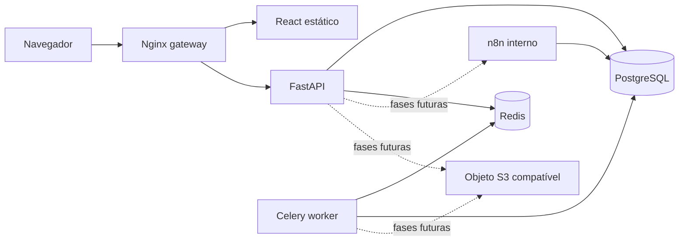
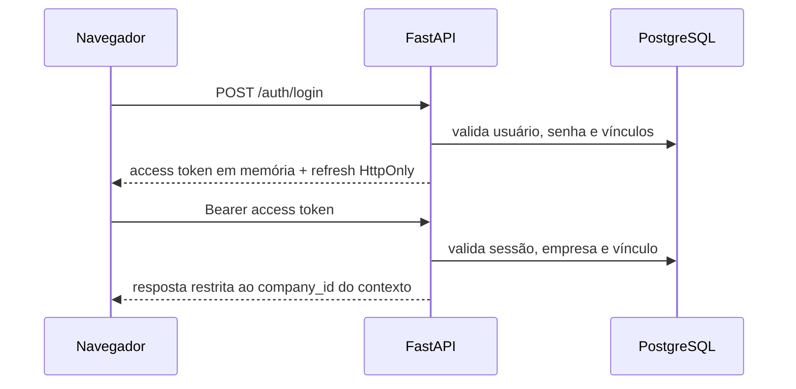

# Arquitetura da fundação

## Fluxo de execução

O gateway é o único serviço publicado no Compose base. Redes internas independentes limitam a comunicação entre persistência, automação e armazenamento.

## Identidade e contexto multiempresa

O cliente nunca escolhe livremente um `company_id` para operações do tenant. A empresa atual vem da sessão autenticada e só é aceita quando existe vínculo ativo. Administradores da plataforma gerenciam o cadastro global de empresas; proprietários gerenciam membros exclusivamente na empresa selecionada.

## Limites atuais

- Papéis e permissões configuráveis começam na Fase 3; na Fase 2 existe apenas a distinção mínima entre administrador da plataforma e proprietário da empresa.
- O worker executa somente uma tarefa de diagnóstico.
- n8n e armazenamento são provisionados, mas não possuem integração funcional com a API.
- O pacote de plugins está deliberadamente vazio até a Fase 5.

## Convenções

- Rotas tratam HTTP; serviços concentram casos de uso; repositórios futuros concentrarão acesso ao banco.
- Todos os erros HTTP seguem `ProblemDetails` e carregam `request_id`.
- Logs são JSON e não incluem corpo de requisição, credenciais ou mensagens cruas de exceções inesperadas.
- Dependências externas recebem timeout; readiness nunca retorna mensagens internas de erro.
- O gateway apresenta as APIs em `/api`; internamente a aplicação FastAPI mantém as rotas sem esse prefixo. Versionamento de módulos de negócio será introduzido quando necessário.
