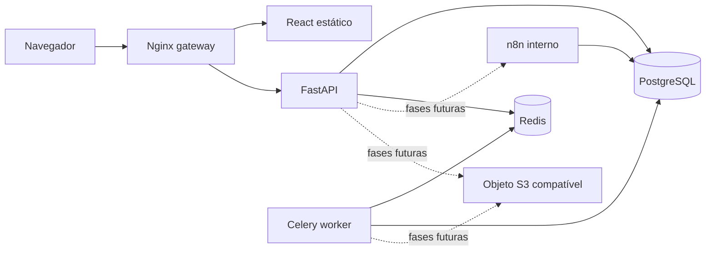

# Arquitetura da fundação

## Fluxo de execução

O gateway é o único serviço publicado no Compose base. Redes internas independentes limitam a comunicação entre persistência, automação e armazenamento.

## Limites atuais

- A API contém apenas endpoints operacionais e nenhuma tabela de negócio.
- O worker executa somente uma tarefa de diagnóstico.
- n8n e armazenamento são provisionados, mas não possuem integração funcional com a API.
- O pacote de plugins está deliberadamente vazio até a Fase 5.

## Convenções

- Rotas tratam HTTP; serviços concentram casos de uso; repositórios futuros concentrarão acesso ao banco.
- Todos os erros HTTP seguem `ProblemDetails` e carregam `request_id`.
- Logs são JSON e não incluem corpo de requisição, credenciais ou mensagens cruas de exceções inesperadas.
- Dependências externas recebem timeout; readiness nunca retorna mensagens internas de erro.
- APIs de negócio futuras usarão `/api/v1`; `/health` e `/ready` permanecem sem versão.
